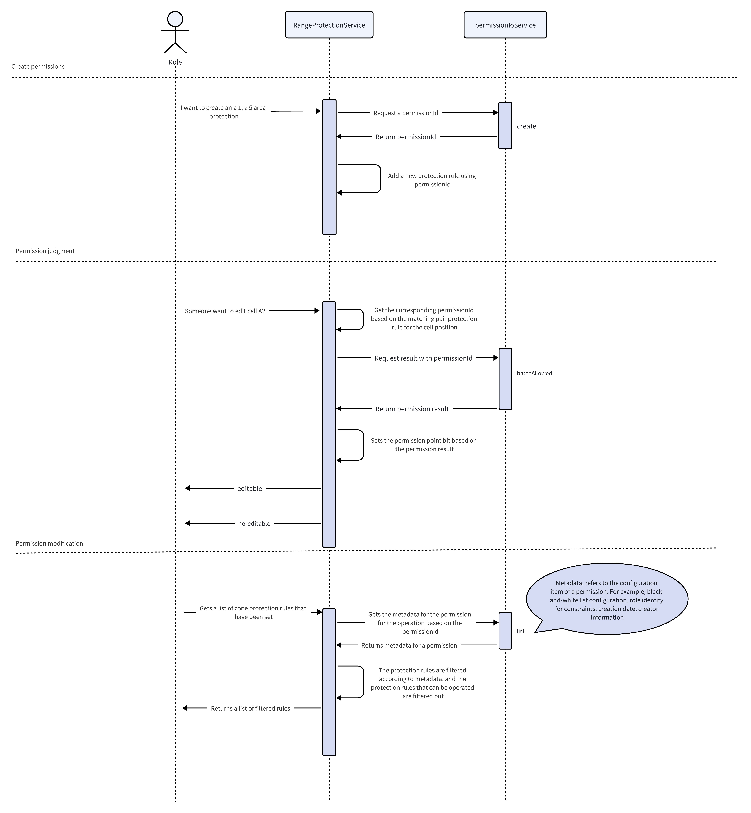

import { PermissionShadowDemo } from './components/permission-shadow-demo'

El control de permisos en Univer determina lo que un usuario puede hacer en un libro de trabajo, una hoja de trabajo o un rango. Cuando un usuario intenta una operación sin el permiso requerido, Univer detiene la operación e informa el permiso perdido. Proteger un rango, por ejemplo, controla si los colaboradores pueden editar, ver, copiar o filtrar contenido dentro de él.

<Callout type="warning">
Su servicio debe persistir reglas de protección y cambios de colaboradores, devolver los permisos del usuario actual, y pasar los fallos de solicitud de vuelta al callador. Un mock que devuelve una lista vacía no es una capa de persistencia. En colaboración, el backend también debe comprobar los permisos de lectura, unión y mutación en sí mismo; ver [Identidad y autorización](/server/collaboration/identity-and-authorization). La protección en la interfaz de usuario y sombras ocultas no reemplazan la autorización del servidor.

[Integración del servicio de autorización](#authorization-service)
</Callout>

<PlaygroundFrame lang="en-US" slug="sheets/permission" clickToShow />

Esta página cubre operaciones básicas, ejemplos avanzados, configuración y solución de problemas. Los contratos completos de API se recogen en Referencia.

- [Tareas habituales](#permission-tasks)
- [Configuración de la interfaz de permisos](#permission-ui)
- [Integración del servicio de autorización](#permission-integration)
- [Reference](#reference)

## Conceptos principales

- Alcance: Las permisos se aplican en tres niveles: libro de trabajo, hoja de trabajo y rango.
- Puntos de Permisión: Cada característica tiene un punto de permiso, y cambiar su valor permite o deshabilita esa característica.
- Reglas de protección: Una hoja de trabajo o un rango necesita una regla de protección antes de que se puedan establecer sus puntos de permiso.

<Callout type="info">
Los permisos locales sin persistencia se modifican mediante puntos de permiso. Para persistencia, consulte [Integración del servicio de autorización](#authorization-service).

En la edición colaborativa, actualizar un punto de permiso también actualiza el estado del servidor:
  - `false`: el punto de permiso requiere al menos el rol `owner`
  - `true`: el punto de permiso requiere al menos el `reader` rol
</Callout>

## Ejemplo básico

Antes de utilizar los ejemplos `allowedUsers`, sustitúyase `user1` y `user2` con IDs de colaboradores reales devueltos por su servicio de autorización.

Los ejemplos a continuación muestran la forma habitual de establecer permisos en cada uno de los tres niveles: libro de trabajo, hoja de trabajo y rango.

### Ejemplo de código de permisos de libro de trabajo

Establecer permisos a nivel de libro de trabajo directamente a través de [Facade API](/guides/sheets/getting-started/facade).

El ejemplo a continuación deshabilita la edición para todo el libro de trabajo. Para controlar otra característica, reemplace el punto de permiso con el que coincida; vea el [lista de puntos de permiso de libro de trabajo](#workbook-point):

```typescript
const fWorkbook = univerAPI.getActiveWorkbook()
if (!fWorkbook) throw new Error('No active workbook')
const workbookPermission = fWorkbook.getWorkbookPermission()

// Set the workbook to be non-editable
await workbookPermission.setPoint(univerAPI.Enum.WorkbookPermissionPoint.Edit, false)
```

Los puntos de permiso del libro de trabajo se pueden establecer directamente, sin crear una regla de protección primero.

### Ejemplo de código de permisos de hoja de trabajo

Los permisos de hoja de trabajo y rango se pueden configurar a través de Facade API o a través de comandos. Este ejemplo establece el permiso de edición de hoja de cálculo. Para controlar otra característica, reemplace el punto de permiso con el que coincida; vea el [lista de puntos de permiso de hoja de trabajo](#worksheet-point):

```typescript
const fWorkbook = univerAPI.getActiveWorkbook()
if (!fWorkbook) throw new Error('No active workbook')
const fWorksheet = fWorkbook.getActiveSheet()
const worksheetPermission = fWorksheet.getWorksheetPermission()

// Create worksheet protection, allow specified users to edit
const permissionId = await worksheetPermission.protect({
  allowedUsers: ['user1', 'user2'],
  name: 'My Worksheet Protection',
})

// To set permission points, you must first protect the worksheet
await worksheetPermission.setPoint(univerAPI.Enum.WorksheetPermissionPoint.Edit, false)
```

#### Eliminar permisos de hoja de trabajo

```typescript
const fWorkbook = univerAPI.getActiveWorkbook()
if (!fWorkbook) throw new Error('No active workbook')
const fWorksheet = fWorkbook.getActiveSheet()
const worksheetPermission = fWorksheet.getWorksheetPermission()

// Remove worksheet protection
await worksheetPermission.unprotect()
```

### Ejemplo de código de permisos de rango personalizado

Los permisos de rango se pueden establecer de las mismas dos maneras: a través de la API o a través de comandos. El ejemplo a continuación utiliza el permiso de edición de rango. Otras características de rango requieren un punto de permiso diferente; vea el [lista de puntos de permiso - Rango](#range-point) para detalles.

```typescript
const fWorkbook = univerAPI.getActiveWorkbook()
if (!fWorkbook) throw new Error('No active workbook')
const fWorksheet = fWorkbook.getActiveSheet()
const fRange = fWorksheet.getRange('A1:B2')
const rangePermission = fRange.getRangePermission()

// Set range protection permission, allow specified users to edit but not allow others to view
const rule = await rangePermission.protect({
  name: 'My protected range',
  allowViewByOthers: false,
  allowedUsers: ['user1', 'user2'],
})
console.log(rule)

// To set permission points, you must first create a range protection rule.
await rule.setPoint(univerAPI.Enum.RangePermissionPoint.Edit, false)
await rule.setPoint(univerAPI.Enum.RangePermissionPoint.View, true)
```

#### Eliminar permisos de protección de rango

```typescript
const fWorkbook = univerAPI.getActiveWorkbook()
if (!fWorkbook) throw new Error('No active workbook')
const fWorksheet = fWorkbook.getActiveSheet()
const fRange = fWorksheet.getRange('A1:B2')
const rangePermission = fRange.getRangePermission()

// delete all rules within the range
await rangePermission.unprotect()

// Or delete specific rules within the range
const rules = await rangePermission.listRules()
if (rules.length > 0) {
  await rules[0].remove()
}
```

## Tareas habituales [#permission-tasks]

### Poner un libro en modo de solo lectura

```typescript
const fWorkbook = univerAPI.getActiveWorkbook()
if (!fWorkbook) throw new Error('No active workbook')
const permission = fWorkbook.getWorkbookPermission()
await permission.setMode('viewer')
console.log(permission.getSnapshot())
```

### Gestionar rangos protegidos

```typescript
const fWorkbook = univerAPI.getActiveWorkbook()
if (!fWorkbook) throw new Error('No active workbook')
const fWorksheet = fWorkbook.getActiveSheet()
const permission = fWorksheet.getWorksheetPermission()

const createdRules = await permission.protectRanges([
  {
    ranges: [fWorksheet.getRange('A1:B2')],
    options: { name: 'Public area', allowViewByOthers: true },
  },
  {
    ranges: [fWorksheet.getRange('C3:D4')],
    options: { name: 'Private area', allowViewByOthers: false, allowedUsers: ['user1'] },
  },
])
console.log(createdRules)

const rules = await permission.listRangeProtectionRules()
const firstRule = rules[0]
if (firstRule) {
  await firstRule.updateRanges([fWorksheet.getRange('A1:B3')])
}
```

### Diagnosticar permisos de una celda

```typescript
const fWorkbook = univerAPI.getActiveWorkbook()
if (!fWorkbook) throw new Error('No active workbook')
const permission = fWorkbook.getActiveSheet().getWorksheetPermission()
console.log(permission.debugCellPermission(0, 0))
```

## Lista de puntos de permiso [#point-list]

El código fuente para cada punto de permiso es [aquí.](https://github.com/dream-num/univer/tree/dev/packages/sheets/src/services/permission/permission-point).

Cuando tanto un permiso de libro de trabajo como una hoja de trabajo o permiso de rango cubren una característica, **todo** de los permisos pertinentes debe ser `true` antes de que la característica funciona.

### Permisos del libro de trabajo [#workbook-point]

| Enumeración API  | Clase de punto de permiso correspondiente | Descripción |
| --- | --- | --- |
| univerAPI.Enum.WorkbookPermissionPoint.Edit | WorkbookEditablePermission | Puede editar |
| univerAPI.Enum.WorkbookPermissionPoint.View | WorkbookViewPermission | Puede ver |
| univerAPI.Enum.WorkbookPermissionPoint.Print | WorkbookPrintPermission | Puede imprimir |
| univerAPI.Enum.WorkbookPermissionPoint.Export | WorkbookExportPermission | Puede exportar |
| univerAPI.Enum.WorkbookPermissionPoint.Share | WorkbookSharePermission | Puede compartir |
| univerAPI.Enum.WorkbookPermissionPoint.CopyContent | WorkbookCopyPermission | Puede copiar |
| univerAPI.Enum.WorkbookPermissionPoint.DuplicateFile | WorkbookDuplicatePermission | Puede duplicar |
| univerAPI.Enum.WorkbookPermissionPoint.Comment | WorkbookCommentPermission | Puede comentar |
| univerAPI.Enum.WorkbookPermissionPoint.ManageCollaborator | WorkbookManageCollaboratorPermission | Puede administrar colaboradores |
| univerAPI.Enum.WorkbookPermissionPoint.CreateSheet | WorkbookCreateSheetPermission | Pueden crear hojas de trabajo |
| univerAPI.Enum.WorkbookPermissionPoint.DeleteSheet | WorkbookDeleteSheetPermission | Pueden eliminar hojas de trabajo |
| univerAPI.Enum.WorkbookPermissionPoint.RenameSheet | WorkbookRenameSheetPermission | Pueden cambiar el nombre de las hojas de trabajo |
| univerAPI.Enum.WorkbookPermissionPoint.MoveSheet | WorkbookMoveSheetPermission | Pueden mover hojas de trabajo |
| univerAPI.Enum.WorkbookPermissionPoint.HideSheet | WorkbookHideSheetPermission | Puede ocultar hojas de trabajo |
| univerAPI.Enum.WorkbookPermissionPoint.CopySheet | WorkbookCopySheetPermission | Puede copiar hojas de trabajo |
| univerAPI.Enum.WorkbookPermissionPoint.ViewHistory | WorkbookViewHistoryPermission | Puede ver el historial |
| univerAPI.Enum.WorkbookPermissionPoint.RecoverHistory | WorkbookRecoverHistoryPermission | Puede recuperar el historial |
| univerAPI.Enum.WorkbookPermissionPoint.CreateProtection | WorkbookCreateProtectPermission | Puede crear protección |
| univerAPI.Enum.WorkbookPermissionPoint.InsertRow | WorkbookInsertRowPermission | Puede insertar filas |
| univerAPI.Enum.WorkbookPermissionPoint.InsertColumn | WorkbookInsertColumnPermission | Puede insertar columnas |
| univerAPI.Enum.WorkbookPermissionPoint.DeleteRow | WorkbookDeleteRowPermission | Puede eliminar filas |
| univerAPI.Enum.WorkbookPermissionPoint.DeleteColumn | WorkbookDeleteColumnPermission | Puede eliminar columnas |

### Permisos de la hoja de trabajo [#worksheet-point]

| Enumeración de API  | Clase de puntos de permiso correspondiente | Descripción |
| --- | --- | --- |
| univerAPI.Enum.WorksheetPermissionPoint.Edit | WorksheetEditPermission | Puede editar |
| univerAPI.Enum.WorksheetPermissionPoint.View | WorksheetViewPermission | Puede ver |
| univerAPI.Enum.WorksheetPermissionPoint.Copy | WorksheetCopyPermission | Puede copiar |
| univerAPI.Enum.WorksheetPermissionPoint.SetCellValue | WorksheetSetCellValuePermission | Puede editar valores de celda |
| univerAPI.Enum.WorksheetPermissionPoint.SetCellStyle | WorksheetSetCellStylePermission | Puede editar estilos de celda |
| univerAPI.Enum.WorksheetPermissionPoint.SetRowStyle | WorksheetSetRowStylePermission | Puede establecer estilos de fila |
| univerAPI.Enum.WorksheetPermissionPoint.SetColumnStyle | WorksheetSetColumnStylePermission | Puede establecer estilos de columna |
| univerAPI.Enum.WorksheetPermissionPoint.InsertRow | WorksheetInsertRowPermission | Puede insertar filas |
| univerAPI.Enum.WorksheetPermissionPoint.InsertColumn | WorksheetInsertColumnPermission | Puede insertar columnas |
| univerAPI.Enum.WorksheetPermissionPoint.DeleteRow | WorksheetDeleteRowPermission | Puede eliminar filas |
| univerAPI.Enum.WorksheetPermissionPoint.DeleteColumn | WorksheetDeleteColumnPermission | Puede eliminar columnas |
| univerAPI.Enum.WorksheetPermissionPoint.Sort | WorksheetSortPermission | Puede ordenar |
| univerAPI.Enum.WorksheetPermissionPoint.Filter | WorksheetFilterPermission | Puede filtrar |
| univerAPI.Enum.WorksheetPermissionPoint.PivotTable | WorksheetPivotTablePermission | Puede usar tablas dinámicas |
| univerAPI.Enum.WorksheetPermissionPoint.InsertHyperlink | WorksheetInsertHyperlinkPermission | Puede usar hipervínculos |
| univerAPI.Enum.WorksheetPermissionPoint.ManageCollaborator | WorksheetManageCollaboratorPermission | Puede administrar colaboradores |
| univerAPI.Enum.WorksheetPermissionPoint.DeleteProtection | WorksheetDeleteProtectionPermission | Puede eliminar protección |
| univerAPI.Enum.WorksheetPermissionPoint.EditExtraObject | WorksheetEditExtraObjectPermission | Puede editar objetos adicionales |
| univerAPI.Enum.WorksheetPermissionPoint.SelectProtectedCells | WorksheetSelectProtectedCellsPermission | Puede seleccionar celdas protegidas |
| univerAPI.Enum.WorksheetPermissionPoint.SelectUnProtectedCells | WorksheetSelectUnProtectedCellsPermission | Puede seleccionar celdas desprotegidas |

### Protección de rango [#range-point]

| API Enum  | Clase de puntos de permiso correspondiente | Descripción |
| --- | --- | --- |
| univerAPI.Enum.RangePermissionPoint.Edit | RangeProtectionPermissionEditPoint | Puede editar rangos protegidos |
| univerAPI.Enum.RangePermissionPoint.View | RangeProtectionPermissionViewPoint | Puede ver el contenido de rangos protegidos |
| univerAPI.Enum.RangePermissionPoint.Delete | RangeProtectionPermissionDeleteProtectionPoint | Puede eliminar rangos protegidos |
| univerAPI.Enum.RangePermissionPoint.ManageCollaborator | RangeProtectionPermissionManageCollaPoint | Puede administrar colaboradores para rangos protegidos |

## Configuración de plugins [#plugin-configuration]

`UniverSheetsUIPlugin`

| <span data-config-options="">Opción</span> | Tipo | Valor predeterminado | Efecto |
| --- | --- | --- | --- |
| `protectedRangeShadow` | `boolean \| 'always' \| 'non-editable' \| 'non-viewable' \| 'none'` | `true` | Que rangos protegidos muestran una sombra. |
| <ConfigKey depth={0}>protectedRangeUserSelector</ConfigKey> | `object` |  | Personalizar el picker utilizado para elegir usuarios de un rango protegido. |
| <ConfigKey depth={1}>component</ConfigKey> | `ComponentType<IPermissionDetailUserPartProps>` |  | Componente que elige usuarios. |
| <ConfigKey depth={1}>framework</ConfigKey> | `string` |  | Marco del componente utiliza, por ejemplo `react`. |

## Configuración de preajustes [#preset-configuration]

`UniverSheetsCorePreset`

| <span data-config-options="">Opción</span> | Tipo | Valor predeterminado | Efecto |
| --- | --- | --- | --- |
| <ConfigKey depth={0}>sheets</ConfigKey> | `object` |  | Opciones para la función seleccionada. |
| <ConfigKey depth={1}>protectedRangeShadow</ConfigKey> | `boolean \| 'always' \| 'non-editable' \| 'non-viewable' \| 'none'` | `true` | Que rangos protegidos muestran una sombra. |
| <ConfigKey depth={1}>protectedRangeUserSelector</ConfigKey> | `object` |  | Personalizar el picker utilizado para elegir usuarios de un rango protegido. |
| <ConfigKey depth={2}>component</ConfigKey> | `ComponentType<IPermissionDetailUserPartProps>` |  | Componente que elige usuarios. |
| <ConfigKey depth={2}>framework</ConfigKey> | `string` |  | Marco del componente utiliza, por ejemplo `react`. |

## Estrategia de sombra de rango protegido [#permission-ui]

Utilice `non-editable` para distinguir las áreas protegidas que el usuario actual puede editar de aquellas que no pueden. Áreas editables no reciben sombra, áreas con la edición de discapacitados mantienen su sombra, y los rangos no visibles permanecen enmascarados.

La configuración sólo afecta cómo se muestra la protección de rango y hoja de trabajo. No crea reglas de protección, no cambia los permisos de edición o vista, y no añade sombras a áreas desprotegidas. Configure las reglas de protección y los permisos del usuario actual primero, como se describe anteriormente.

| Estrategia | Visualización |
| --- | --- |
| `true` / `'always'` | Muestra sombras en todas las áreas protegidas (predeterminado). |
| `'non-editable'` | Oculta las sombras de las áreas protegidas editables y las conserva en las no editables. |
| `'non-viewable'` | Muestra sombras solo en las áreas protegidas que no se pueden ver. |
| `false` / `'none'` | Oculta todas las sombras de protección; las comprobaciones de permisos siguen activas. |

<PermissionShadowDemo />

Define la estrategia durante la inicialización:

<Tabs items={['Plugin Mode', 'Preset Mode']}>
  <Tab>
    ```typescript
    univer.registerPlugin(UniverSheetsUIPlugin, {
      protectedRangeShadow: 'non-editable',
    })
    ```
  </Tab>
  <Tab>
    ```typescript
    createUniver({
      presets: [
        UniverSheetsCorePreset({
          sheets: {
            protectedRangeShadow: 'non-editable',
          },
        }),
      ],
    })
    ```
  </Tab>
</Tabs>

## Componente de usuario personalizado

El selector de usuario integrado cubre un conjunto limitado de casos. Cuando sus requisitos lo excedan, proporcione un componente personalizado:

<Callout>
  Para obtener más información sobre el edificio uno, consulte [Componentes aduaneros](/guides/sheets/ui/components).
</Callout>

<Tabs items={['Plugin Mode', 'Preset Mode']}>
  <Tab>
    ```typescript
    univer.registerPlugin(UniverSheetsUIPlugin, {
      protectedRangeUserSelector: {
        /**
         * Custom component; must implement the `IPermissionDetailUserPartProps` interface.
         */
        component: CustomPermissionDetailUserPart,
        /**
         * The framework of the component. Must be passed correctly.
         */
        framework: 'react',
      },
    })
    ```
  </Tab>
  <Tab>
    ```typescript
    const { univer } = createUniver({
      presets: [
        UniverSheetsCorePreset({
          sheets: {
            protectedRangeUserSelector: {
            /**
             * Custom component; must implement the `IPermissionDetailUserPartProps` interface.
             */
              component: CustomPermissionDetailUserPart,
              /**
               * The framework of the component. Must be passed correctly.
               */
              framework: 'react',
            },
          },
        }),
      ],
    })
    ```
  </Tab>
</Tabs>

## Actualizar la interfaz de permisos con la API Facade [#permission-ui-api]

### Estrategia de sombra de rango protegido [#protected-range-shadow-api]

El Facade API a continuación cambia los libros de trabajo existentes en la instancia Univer actual. En modo plugin, importar `@univerjs/sheets-ui/facade` primero; el preset de Hojas Core ya incluye ese módulo.

```typescript
// Set to only show shadows for non-editable ranges
univerAPI.setProtectedRangeShadowStrategy('non-editable')

// Get the current protected range shadow display strategy
console.log(univerAPI.getProtectedRangeShadowStrategy())

// Subscribe to changes in the protected range shadow strategy
const subscription = univerAPI.getProtectedRangeShadowStrategy$().subscribe((strategy) => {
  console.log('Global strategy changed to:', strategy)
  // Update UI or perform other actions
})

// Later, unsubscribe to clean up
subscription.unsubscribe()
```

### Componente de usuario personalizado [#permission-user-picker-api]

Llame a `setSelectUserList()` desde el controlador de cambio de su usuario. El ejemplo React a continuación aclara la selección. `useDependency` funciona dentro del componente, y el servicio se actualiza sólo después de un clic. Construya las partes restantes del selector contra `IPermissionDetailUserPartProps`.

<Tabs items={['Modo de complemento', 'Modo preestablecido']}>
  <Tab>
    ```tsx
    import type { IPermissionDetailUserPartProps } from '@univerjs/sheets-ui'
    import type { FC } from 'react'
    import { SheetPermissionUserManagerService } from '@univerjs/sheets-ui'
    import { useDependency } from '@univerjs/ui'

    export const CustomPermissionDetailUserPart: FC<IPermissionDetailUserPartProps> = () => {
      const service = useDependency(SheetPermissionUserManagerService)
      const clearSelection = () => service.setSelectUserList([])

      return <button type="button" onClick={clearSelection}>Borrar usuarios seleccionados</button>
    }
    ```
  </Tab>
  <Tab>
    ```tsx
    import type { IPermissionDetailUserPartProps } from '@univerjs/preset-sheets-core'
    import type { FC } from 'react'
    import { SheetPermissionUserManagerService, useDependency } from '@univerjs/preset-sheets-core'

    export const CustomPermissionDetailUserPart: FC<IPermissionDetailUserPartProps> = () => {
      const service = useDependency(SheetPermissionUserManagerService)
      const clearSelection = () => service.setSelectUserList([])

      return <button type="button" onClick={clearSelection}>Borrar usuarios seleccionados</button>
    }
    ```
  </Tab>
</Tabs>

### Ocultar el cuadro de diálogo de permiso

```typescript
univerAPI.setPermissionDialogVisible(false)
```

## Integración del servicio de autorización [#permission-integration]

### Uso extendido

Para comprobar los permisos dentro de su propio plugin, trabaje con los puntos de permiso directamente.

El ejemplo a continuación utiliza `WorkbookEditablePermission`. Otros puntos de permiso siguen el mismo patrón.

```typescript
import { IPermissionService } from '@univerjs/core'
import { WorkbookEditablePermission } from '@univerjs/sheets'

class YourService {
  constructor(@IPermissionService private _permissionService: IPermissionService) {
  }

  setWorkbookNotEditable() {
    this._permissionService.updatePermissionPoint(new WorkbookEditablePermission('unitId').id, false)
  }

  setWorkbookEditable() {
    this._permissionService.updatePermissionPoint(new WorkbookEditablePermission('unitId').id, true)
  }
}
```

[Lista de puntos de permiso](#point-list)

### Cómo extender los puntos de permiso

Para puntos de permiso personalizados, implemente `IPermissionPoint` y regístrelo con el servicio de permisos:

```typescript
import type { IPermissionPoint } from '@univerjs/core'
import { IPermissionService, PermissionStatus } from '@univerjs/core'
import { UnitAction, UnitObject } from '@univerjs/protocol'

export class CustomPermissionPoint implements IPermissionPoint {
  type = UnitObject.Unkonwn // your type
  subType = UnitAction.View // your subType
  status = PermissionStatus.INIT
  value = true // Default value
  id: string
  constructor(unitId: string, subUnitId: string, customId: string) {
    // The id must be unique within `IPermissionService`.
    this.id = `${unitId}.${subUnitId}.${customId}`
  }
}

class YourService {
  constructor(@IPermissionService private _permissionService: IPermissionService) {
    this._init()
  }

  _init() {
    this._permissionService.addPermissionPoint(new CustomPermissionPoint('unitId', 'subUnitId', 'my-id'))
  }
}

// How to use it elsewhere
class ConsumeService {
  constructor(@IPermissionService private _permissionService: IPermissionService) {
  }

  doSomething() {
    const point = this._permissionService.getPermissionPoint(new CustomPermissionPoint('unitId', 'subUnitId', 'my-id').id)
    console.log(point?.value)
  }

  bindEvent() {
    // This returns an RxJS observable that lets you listen for permission changes
    const point$ = this._permissionService.getPermissionPoint$(new CustomPermissionPoint('unitId', 'subUnitId', 'my-id').id)
    console.log(point$)
  }
}
```

### Integración de un servicio de autorización de terceros (avanzado) [#authorization-service]

Implemente [IAuthzIoService](https://github.com/dream-num/univer/blob/dev/packages/core/src/services/authz-io/type.ts) en su aplicación y conecte su permiso, papel y métodos de colaboradores a su backend. El ejemplo asume que `./authorization-service` exporta la implementación como `YourAuthzService`. Inscríbelo antes de crear libros de trabajo, y mantenga las otras opciones de inicialización y registros de plugins.

```typescript
import { IAuthzIoService, Univer } from '@univerjs/core'
import { YourAuthzService } from './authorization-service'

const univer = new Univer({
  override: [[IAuthzIoService, { useClass: YourAuthzService }]],
})
```

Su servicio authz debe persistir reglas de protección y cambios de colaboradores, devolver los permisos del usuario actual y los fallos de solicitud de superficie. Un mock que devuelve las listas vacías no persiste nada. En colaboración, el backend debe todavía revisar los permisos de lectura, INGRESO y mutación en sí mismo; vea [Identidad y autorización](/server/collaboration/identity-and-authorization). Protección de interfaz de usuario y sombras ocultas no son un sustituto de la autorización del servidor.



### Administración de colaboradores

<Callout>
  La gestión del colaborador pertenece a su aplicación y a su servicio de permisos. Conecte su propio usuario y modelo ACL, y ejecute políticas de lectura, INGRESO y edición en el servidor; vea [identidad y autorización](/server/collaboration/identity-and-authorization). Las APIs de frontend a continuación requieren una aplicación de permisos de conexión; no configuran la autorización del servidor.
</Callout>

- Obtenga la lista de colaboradores

```typescript
const fWorkbook = univerAPI.getActiveWorkbook()
if (!fWorkbook) throw new Error('No active workbook')
const workbookPermission = fWorkbook.getWorkbookPermission()

const collaborators = await workbookPermission.listCollaborators()
console.log(collaborators)
```

- Agregar colaboradores

```typescript
const fWorkbook = univerAPI.getActiveWorkbook()
if (!fWorkbook) throw new Error('No active workbook')
const workbookPermission = fWorkbook.getWorkbookPermission()

// Add multiple collaborators at once
await workbookPermission.setCollaborators([
  {
    user: { userID: 'user1', name: 'John Doe', avatar: 'https://...' },
    role: univerAPI.Enum.UnitRole.Editor,
  },
  {
    user: { userID: 'user2', name: 'Jane Smith', avatar: '' },
    role: univerAPI.Enum.UnitRole.Reader,
  },
])

// Add a single collaborator
await workbookPermission.addCollaborator(
  { userID: 'user1', name: 'John Doe', avatar: 'https://...' },
  univerAPI.Enum.UnitRole.Editor,
)
```

- Actualizar funciones de colaboradores

```typescript
const fWorkbook = univerAPI.getActiveWorkbook()
if (!fWorkbook) throw new Error('No active workbook')
const workbookPermission = fWorkbook.getWorkbookPermission()

await workbookPermission.updateCollaborator(
  { userID: 'user1', name: 'John Doe Updated', avatar: 'https://...' },
  univerAPI.Enum.UnitRole.Reader,
)
```

- Eliminar colaboradores

```typescript
const fWorkbook = univerAPI.getActiveWorkbook()
if (!fWorkbook) throw new Error('No active workbook')
const workbookPermission = fWorkbook.getWorkbookPermission()

// Remove multiple collaborators
await workbookPermission.removeCollaborators(['user1', 'user2'])

// Remove a single collaborator
await workbookPermission.removeCollaborator('user1')
```

## Reference

- [FWorkbookPermission](/reference/facade/workbook-permission)
- [FWorksheetPermission](/reference/facade/worksheet-permission)
- [FRangePermission](/reference/facade/range-permission)
- [FRangeProtectionRule](/reference/facade/range-protection-rule)
