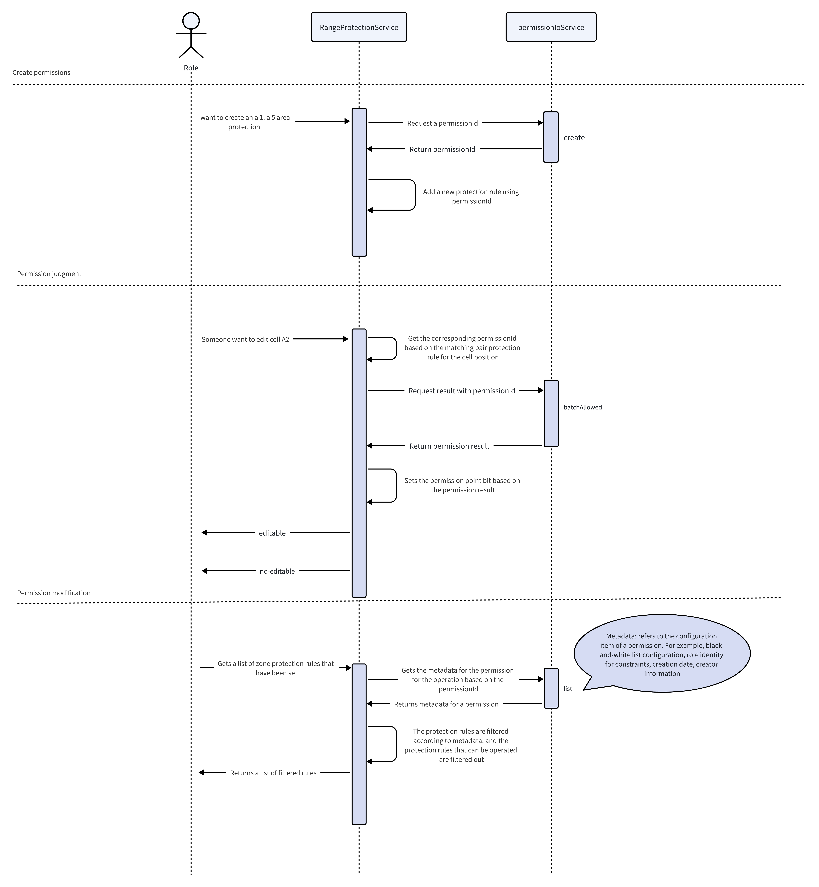

import { PermissionShadowDemo } from './components/permission-shadow-demo'

Univer provides permission control capabilities to restrict user operations on workbooks, worksheets, and ranges. When a user attempts an operation without the required permission, execution is halted and the user is notified. For example, you can protect a range to control whether collaborators can edit, view, copy, or filter within that range.

<Callout type="warning">
Your service must persist protection rules and collaborator changes, return the current user’s permissions, and propagate request failures. Empty mock lists are not a persistence implementation. In collaboration, the backend must independently check read, JOIN, and mutation permissions; see [Identity and authorization](/server/collaboration/identity-and-authorization). UI protection and hiding shadows do not replace server authorization.

[Permission Service Integration](#authorization-service)
</Callout>

<PlaygroundFrame lang="en-US" slug="sheets/permission" clickToShow />

Choose a task below. Basic operations, advanced examples, configuration, and troubleshooting stay on this page; full API contracts are maintained in Reference.

- [Common tasks](#permission-tasks)
- [Permission UI Configuration](#permission-ui)
- [Permission Service Integration](#permission-integration)
- [Reference](#reference)

## Core Concepts

- Scope: Permissions apply at three levels—workbook, worksheet, and range.
- Permission Points: Each feature corresponds to a permission point. Modifying a point controls whether that feature is available.
- Protection Rules: Before setting permission points for worksheets and ranges, you must create a protection rule.

<Callout type="info">
Local, non-persistent permissions can be changed through permission points. For persistence, see [Permission Service Integration](#authorization-service)

In a collaborative editing scenario, updating a permission point synchronizes the server state:
  - `false`: The permission point requires at least the `owner` role
  - `true`: The permission point requires at least the `reader` role
</Callout>

## Basic Example

Replace `user1` and `user2` with real collaborator IDs returned by your authorization service before using the `allowedUsers` examples.

The most common permission setting methods are shown below at three levels: workbook, worksheet, and range.

### Workbook Permissions Code Example

Workbook-level permissions can be set directly via the [Facade API](/guides/sheets/getting-started/facade).

The following example disables editing for the entire workbook. For other functions, replace the permission point accordingly (see the [workbook permission points list](#workbook-point)):

```typescript
const fWorkbook = univerAPI.getActiveWorkbook()
if (!fWorkbook) throw new Error('No active workbook')
const workbookPermission = fWorkbook.getWorkbookPermission()

// Set the workbook to be non-editable
await workbookPermission.setPoint(univerAPI.Enum.WorkbookPermissionPoint.Edit, false)
```

Key points:
- Workbook permission points can be set directly without creating protection rules.

### Worksheet Permissions Code Example

Worksheet and range permissions can be set via the Facade API or commands. The following example demonstrates how to set worksheet edit permissions. For other features, replace the permission point accordingly (see the [worksheet permission points list](#worksheet-point)):

```typescript
const fWorkbook = univerAPI.getActiveWorkbook()
if (!fWorkbook) throw new Error('No active workbook')
const fWorksheet = fWorkbook.getActiveSheet()
const worksheetPermission = fWorksheet.getWorksheetPermission()

// Create worksheet protection, allow specified users to edit
const permissionId = await worksheetPermission.protect({
  allowedUsers: ['user1', 'user2'],
  name: 'My Worksheet Protection',
})

// To set permission points, you must first protect the worksheet
await worksheetPermission.setPoint(univerAPI.Enum.WorksheetPermissionPoint.Edit, false)
```

#### Delete Worksheet Permissions

```typescript
const fWorkbook = univerAPI.getActiveWorkbook()
if (!fWorkbook) throw new Error('No active workbook')
const fWorksheet = fWorkbook.getActiveSheet()
const worksheetPermission = fWorksheet.getWorksheetPermission()

// Remove worksheet protection
await worksheetPermission.unprotect()
```

### Custom Range Permissions Code Example

Range permissions can also be set via API and command modes. Here, we'll use range edit permissions as an example. Other range functions require replacing the permission points, see the [list of permission points - Range](#range-point) for details.

```typescript
const fWorkbook = univerAPI.getActiveWorkbook()
if (!fWorkbook) throw new Error('No active workbook')
const fWorksheet = fWorkbook.getActiveSheet()
const fRange = fWorksheet.getRange('A1:B2')
const rangePermission = fRange.getRangePermission()

// Set range protection permission, allow specified users to edit but not allow others to view
const rule = await rangePermission.protect({
  name: 'My protected range',
  allowViewByOthers: false,
  allowedUsers: ['user1', 'user2'],
})
console.log(rule)

// To set permission points, you must first create a range protection rule.
await rule.setPoint(univerAPI.Enum.RangePermissionPoint.Edit, false)
await rule.setPoint(univerAPI.Enum.RangePermissionPoint.View, true)
```

#### Delete Range Protection Permissions

```typescript
const fWorkbook = univerAPI.getActiveWorkbook()
if (!fWorkbook) throw new Error('No active workbook')
const fWorksheet = fWorkbook.getActiveSheet()
const fRange = fWorksheet.getRange('A1:B2')
const rangePermission = fRange.getRangePermission()

// delete all rules within the range
await rangePermission.unprotect()

// Or delete specific rules within the range
const rules = await rangePermission.listRules()
if (rules.length > 0) {
  await rules[0].remove()
}
```

## Common tasks [#permission-tasks]

### Set a workbook to read-only

```typescript
const fWorkbook = univerAPI.getActiveWorkbook()
if (!fWorkbook) throw new Error('No active workbook')
const permission = fWorkbook.getWorkbookPermission()
await permission.setMode('viewer')
console.log(permission.getSnapshot())
```

### Manage protected ranges

```typescript
const fWorkbook = univerAPI.getActiveWorkbook()
if (!fWorkbook) throw new Error('No active workbook')
const fWorksheet = fWorkbook.getActiveSheet()
const permission = fWorksheet.getWorksheetPermission()

const createdRules = await permission.protectRanges([
  {
    ranges: [fWorksheet.getRange('A1:B2')],
    options: { name: 'Public area', allowViewByOthers: true },
  },
  {
    ranges: [fWorksheet.getRange('C3:D4')],
    options: { name: 'Private area', allowViewByOthers: false, allowedUsers: ['user1'] },
  },
])
console.log(createdRules)

const rules = await permission.listRangeProtectionRules()
const firstRule = rules[0]
if (firstRule) {
  await firstRule.updateRanges([fWorksheet.getRange('A1:B3')])
}
```

### Diagnose cell permissions

```typescript
const fWorkbook = univerAPI.getActiveWorkbook()
if (!fWorkbook) throw new Error('No active workbook')
const permission = fWorkbook.getActiveSheet().getWorksheetPermission()
console.log(permission.debugCellPermission(0, 0))
```

## List of permission points [#point-list]

You can view the source code for all permission points [here](https://github.com/dream-num/univer/tree/dev/packages/sheets/src/services/permission/permission-point).

When workbook permissions overlap with worksheet or range permissions, **all** relevant permissions must be set to `true` for the feature to be usable.

### Workbook Permissions [#workbook-point]

| API Enum  | Corresponding Permission Point Class | Description |
| --- | --- | --- |
| univerAPI.Enum.WorkbookPermissionPoint.Edit | WorkbookEditablePermission | Can edit |
| univerAPI.Enum.WorkbookPermissionPoint.View | WorkbookViewPermission | Can view |
| univerAPI.Enum.WorkbookPermissionPoint.Print | WorkbookPrintPermission | Can print |
| univerAPI.Enum.WorkbookPermissionPoint.Export | WorkbookExportPermission | Can export |
| univerAPI.Enum.WorkbookPermissionPoint.Share | WorkbookSharePermission | Can share |
| univerAPI.Enum.WorkbookPermissionPoint.CopyContent | WorkbookCopyPermission | Can copy |
| univerAPI.Enum.WorkbookPermissionPoint.DuplicateFile | WorkbookDuplicatePermission | Can duplicate |
| univerAPI.Enum.WorkbookPermissionPoint.Comment | WorkbookCommentPermission | Can comment |
| univerAPI.Enum.WorkbookPermissionPoint.ManageCollaborator | WorkbookManageCollaboratorPermission | Can manage collaborators |
| univerAPI.Enum.WorkbookPermissionPoint.CreateSheet | WorkbookCreateSheetPermission | Can create worksheets |
| univerAPI.Enum.WorkbookPermissionPoint.DeleteSheet | WorkbookDeleteSheetPermission | Can delete worksheets |
| univerAPI.Enum.WorkbookPermissionPoint.RenameSheet | WorkbookRenameSheetPermission | Can rename worksheets |
| univerAPI.Enum.WorkbookPermissionPoint.MoveSheet | WorkbookMoveSheetPermission | Can move worksheets |
| univerAPI.Enum.WorkbookPermissionPoint.HideSheet | WorkbookHideSheetPermission | Can hide worksheets |
| univerAPI.Enum.WorkbookPermissionPoint.CopySheet | WorkbookCopySheetPermission | Can copy worksheets |
| univerAPI.Enum.WorkbookPermissionPoint.ViewHistory | WorkbookViewHistoryPermission | Can view history |
| univerAPI.Enum.WorkbookPermissionPoint.RecoverHistory | WorkbookRecoverHistoryPermission | Can recover history |
| univerAPI.Enum.WorkbookPermissionPoint.CreateProtection | WorkbookCreateProtectPermission | Can create protection |
| univerAPI.Enum.WorkbookPermissionPoint.InsertRow | WorkbookInsertRowPermission | Can insert rows |
| univerAPI.Enum.WorkbookPermissionPoint.InsertColumn | WorkbookInsertColumnPermission | Can insert columns |
| univerAPI.Enum.WorkbookPermissionPoint.DeleteRow | WorkbookDeleteRowPermission | Can delete rows |
| univerAPI.Enum.WorkbookPermissionPoint.DeleteColumn | WorkbookDeleteColumnPermission | Can delete columns |

### Worksheet Permissions [#worksheet-point]

| API Enum  | Corresponding Permission Point Class | Description |
| --- | --- | --- |
| univerAPI.Enum.WorksheetPermissionPoint.Edit | WorksheetEditPermission | Can edit |
| univerAPI.Enum.WorksheetPermissionPoint.View | WorksheetViewPermission | Can view |
| univerAPI.Enum.WorksheetPermissionPoint.Copy | WorksheetCopyPermission | Can copy |
| univerAPI.Enum.WorksheetPermissionPoint.SetCellValue | WorksheetSetCellValuePermission | Can edit cell values |
| univerAPI.Enum.WorksheetPermissionPoint.SetCellStyle | WorksheetSetCellStylePermission | Can edit cell styles |
| univerAPI.Enum.WorksheetPermissionPoint.SetRowStyle | WorksheetSetRowStylePermission | Can set row styles |
| univerAPI.Enum.WorksheetPermissionPoint.SetColumnStyle | WorksheetSetColumnStylePermission | Can set column styles |
| univerAPI.Enum.WorksheetPermissionPoint.InsertRow | WorksheetInsertRowPermission | Can insert rows |
| univerAPI.Enum.WorksheetPermissionPoint.InsertColumn | WorksheetInsertColumnPermission | Can insert columns |
| univerAPI.Enum.WorksheetPermissionPoint.DeleteRow | WorksheetDeleteRowPermission | Can delete rows |
| univerAPI.Enum.WorksheetPermissionPoint.DeleteColumn | WorksheetDeleteColumnPermission | Can delete columns |
| univerAPI.Enum.WorksheetPermissionPoint.Sort | WorksheetSortPermission | Can sort |
| univerAPI.Enum.WorksheetPermissionPoint.Filter | WorksheetFilterPermission | Can filter |
| univerAPI.Enum.WorksheetPermissionPoint.PivotTable | WorksheetPivotTablePermission | Can use pivot tables |
| univerAPI.Enum.WorksheetPermissionPoint.InsertHyperlink | WorksheetInsertHyperlinkPermission | Can use hyperlinks |
| univerAPI.Enum.WorksheetPermissionPoint.ManageCollaborator | WorksheetManageCollaboratorPermission | Can manage collaborators |
| univerAPI.Enum.WorksheetPermissionPoint.DeleteProtection | WorksheetDeleteProtectionPermission | Can delete protection |
| univerAPI.Enum.WorksheetPermissionPoint.EditExtraObject | WorksheetEditExtraObjectPermission | Can edit extra objects |
| univerAPI.Enum.WorksheetPermissionPoint.SelectProtectedCells | WorksheetSelectProtectedCellsPermission | Can select protected cells |
| univerAPI.Enum.WorksheetPermissionPoint.SelectUnProtectedCells | WorksheetSelectUnProtectedCellsPermission | Can select unprotected cells |

### Range Protection [#range-point]

| API Enum  | Corresponding Permission Point Class | Description |
| --- | --- | --- |
| univerAPI.Enum.RangePermissionPoint.Edit | RangeProtectionPermissionEditPoint | Can edit protected ranges |
| univerAPI.Enum.RangePermissionPoint.View | RangeProtectionPermissionViewPoint | Can view content of protected ranges |
| univerAPI.Enum.RangePermissionPoint.Delete | RangeProtectionPermissionDeleteProtectionPoint | Can delete protected ranges |
| univerAPI.Enum.RangePermissionPoint.ManageCollaborator | RangeProtectionPermissionManageCollaPoint | Can manage collaborators for protected ranges |

## Permission UI Configuration [#permission-ui]

### Protected Range Shadow Strategy

To distinguish protected areas that the current user can edit from those they cannot, use `non-editable`. Editable protected areas have no shadow; protected areas with editing disabled keep their shadow. Non-viewable protected ranges remain masked.

This setting controls the display of range and worksheet protection. It does not create protection rules or change edit/view permissions, and it does not add shadows to unprotected areas. Configure the protection rules and the current user's permissions first, as shown above.

| Strategy | Display behavior |
| --- | --- |
| `true` / `'always'` | Show shadows for all protected areas (default). |
| `'non-editable'` | Hide shadows on editable protected areas; keep them on non-editable areas. |
| `'non-viewable'` | Show shadows only on non-viewable protected areas. |
| `false` / `'none'` | Hide all protection shadows; permission checks still apply. |

<PermissionShadowDemo />

Set the strategy during initialization:

<Tabs items={['Plugin Mode', 'Preset Mode']}>
  <Tab>
    ```typescript
    univer.registerPlugin(UniverSheetsUIPlugin, {
      protectedRangeShadow: 'non-editable',
    })
    ```
  </Tab>
  <Tab>
    ```typescript
    createUniver({
      presets: [
        UniverSheetsCorePreset({
          sheets: {
            protectedRangeShadow: 'non-editable',
          },
        }),
      ],
    })
    ```
  </Tab>
</Tabs>

You can also modify it dynamically via the API:

The Facade API below updates existing workbooks in the current Univer instance. In plugin mode, first import `@univerjs/sheets-ui/facade`; the Sheets Core preset already includes it.

```typescript
// Set to only show shadows for non-editable ranges
univerAPI.setProtectedRangeShadowStrategy('non-editable')

// Get the current protected range shadow display strategy
console.log(univerAPI.getProtectedRangeShadowStrategy())

// Subscribe to changes in the protected range shadow strategy
const subscription = univerAPI.getProtectedRangeShadowStrategy$().subscribe((strategy) => {
  console.log('Global strategy changed to:', strategy)
  // Update UI or perform other actions
})

// Later, unsubscribe to clean up
subscription.unsubscribe()
```

### Custom User Component

Univer's built-in user selector has limited flexibility. For more complex scenarios, you can provide a custom component as shown below.

<Callout>
  You can refer to [Custom Components](/guides/sheets/ui/components) for how to create custom components.
</Callout>

<Tabs items={['Plugin Mode', 'Preset Mode']}>
  <Tab>
    ```typescript
    univer.registerPlugin(UniverSheetsUIPlugin, {
      protectedRangeUserSelector: {
        /**
         * Custom component; must implement the `IPermissionDetailUserPartProps` interface.
         */
        component: CustomPermissionDetailUserPart,
        /**
         * The framework of the component. Must be passed correctly.
         */
        framework: 'react',
      },
    })
    ```
  </Tab>
  <Tab>
    ```typescript
    const { univer } = createUniver({
      presets: [
        UniverSheetsCorePreset({
          sheets: {
            protectedRangeUserSelector: {
            /**
             * Custom component; must implement the `IPermissionDetailUserPartProps` interface.
             */
              component: CustomPermissionDetailUserPart,
              /**
               * The framework of the component. Must be passed correctly.
               */
              framework: 'react',
            },
          },
        }),
      ],
    })
    ```
  </Tab>
</Tabs>

Call `setSelectUserList()` from your picker’s change handler. This minimal React example clears the selection; `useDependency` runs inside the component and the service update runs only after a click. Implement the rest of your picker using `IPermissionDetailUserPartProps`.

<Tabs items={['Plugin Mode', 'Preset Mode']}>
  <Tab>
    ```tsx
    import type { IPermissionDetailUserPartProps } from '@univerjs/sheets-ui'
    import type { FC } from 'react'
    import { SheetPermissionUserManagerService } from '@univerjs/sheets-ui'
    import { useDependency } from '@univerjs/ui'

    export const CustomPermissionDetailUserPart: FC<IPermissionDetailUserPartProps> = () => {
      const service = useDependency(SheetPermissionUserManagerService)
      const clearSelection = () => service.setSelectUserList([])

      return <button type="button" onClick={clearSelection}>Clear selected users</button>
    }
    ```
  </Tab>
  <Tab>
    ```tsx
    import type { IPermissionDetailUserPartProps } from '@univerjs/preset-sheets-core'
    import type { FC } from 'react'
    import { SheetPermissionUserManagerService, useDependency } from '@univerjs/preset-sheets-core'

    export const CustomPermissionDetailUserPart: FC<IPermissionDetailUserPartProps> = () => {
      const service = useDependency(SheetPermissionUserManagerService)
      const clearSelection = () => service.setSelectUserList([])

      return <button type="button" onClick={clearSelection}>Clear selected users</button>
    }
    ```
  </Tab>
</Tabs>

### Hide the Permission Dialog

```typescript
univerAPI.setPermissionDialogVisible(false)
```

## Permission Service Integration [#permission-integration]

### Extended usage

When you need to check permissions in your own plugin, you can manipulate the permission points directly.

The following example uses `WorkbookEditablePermission` to demonstrate how to check permissions in your own plugin. Other permission points work similarly.

```typescript
import { IPermissionService } from '@univerjs/core'
import { WorkbookEditablePermission } from '@univerjs/sheets'

class YourService {
  constructor(@IPermissionService private _permissionService: IPermissionService) {
  }

  setWorkbookNotEditable() {
    this._permissionService.updatePermissionPoint(new WorkbookEditablePermission('unitId').id, false)
  }

  setWorkbookEditable() {
    this._permissionService.updatePermissionPoint(new WorkbookEditablePermission('unitId').id, true)
  }
}
```

[List of permission points](#point-list)

### How to Extend Permission Points

To customize permission points, implement `IPermissionPoint` and register it with the permission service:

```typescript
import type { IPermissionPoint } from '@univerjs/core'
import { IPermissionService, PermissionStatus } from '@univerjs/core'
import { UnitAction, UnitObject } from '@univerjs/protocol'

export class CustomPermissionPoint implements IPermissionPoint {
  type = UnitObject.Unkonwn // your type
  subType = UnitAction.View // your subType
  status = PermissionStatus.INIT
  value = true // Default value
  id: string
  constructor(unitId: string, subUnitId: string, customId: string) {
    // The id must be unique within `IPermissionService`.
    this.id = `${unitId}.${subUnitId}.${customId}`
  }
}

class YourService {
  constructor(@IPermissionService private _permissionService: IPermissionService) {
    this._init()
  }

  _init() {
    this._permissionService.addPermissionPoint(new CustomPermissionPoint('unitId', 'subUnitId', 'my-id'))
  }
}

// How to use it elsewhere
class ConsumeService {
  constructor(@IPermissionService private _permissionService: IPermissionService) {
  }

  doSomething() {
    const point = this._permissionService.getPermissionPoint(new CustomPermissionPoint('unitId', 'subUnitId', 'my-id').id)
    console.log(point?.value)
  }

  bindEvent() {
    // This returns an RxJS observable that lets you listen for permission changes
    const point$ = this._permissionService.getPermissionPoint$(new CustomPermissionPoint('unitId', 'subUnitId', 'my-id').id)
    console.log(point$)
  }
}
```

### Integrating a Third-Party Authorization Service (Advanced) [#authorization-service]

Implement [IAuthzIoService](https://github.com/dream-num/univer/blob/dev/packages/core/src/services/authz-io/type.ts) in your application and connect its permission, role, and collaborator methods to your backend. The example assumes that `./authorization-service` exports this implementation as `YourAuthzService`. Register it before creating workbooks; keep the other initialization options and plugin registrations.

```typescript
import { IAuthzIoService, Univer } from '@univerjs/core'
import { YourAuthzService } from './authorization-service'

const univer = new Univer({
  override: [[IAuthzIoService, { useClass: YourAuthzService }]],
})
```

Your service must persist protection rules and collaborator changes, return the current user’s permissions, and propagate request failures. Empty mock lists are not a persistence implementation. In collaboration, the backend must independently check read, JOIN, and mutation permissions; see [Identity and authorization](/server/collaboration/identity-and-authorization). UI protection and hiding shadows do not replace server authorization.



### Collaborator Management

<Callout>
  Collaborator management belongs to your application and permission service. Connect your user/ACL model and enforce server-side read, JOIN, and edit policies; see [identity and authorization](/server/collaboration/identity-and-authorization). The frontend APIs below require a matching permission-service implementation and do not automatically configure server authorization.
</Callout>

- Get Collaborators List

```typescript
const fWorkbook = univerAPI.getActiveWorkbook()
if (!fWorkbook) throw new Error('No active workbook')
const workbookPermission = fWorkbook.getWorkbookPermission()

const collaborators = await workbookPermission.listCollaborators()
console.log(collaborators)
```

- Add Collaborators

```typescript
const fWorkbook = univerAPI.getActiveWorkbook()
if (!fWorkbook) throw new Error('No active workbook')
const workbookPermission = fWorkbook.getWorkbookPermission()

// Add multiple collaborators at once
await workbookPermission.setCollaborators([
  {
    user: { userID: 'user1', name: 'John Doe', avatar: 'https://...' },
    role: univerAPI.Enum.UnitRole.Editor,
  },
  {
    user: { userID: 'user2', name: 'Jane Smith', avatar: '' },
    role: univerAPI.Enum.UnitRole.Reader,
  },
])

// Add a single collaborator
await workbookPermission.addCollaborator(
  { userID: 'user1', name: 'John Doe', avatar: 'https://...' },
  univerAPI.Enum.UnitRole.Editor,
)
```

- Update collaborator role

```typescript
const fWorkbook = univerAPI.getActiveWorkbook()
if (!fWorkbook) throw new Error('No active workbook')
const workbookPermission = fWorkbook.getWorkbookPermission()

await workbookPermission.updateCollaborator(
  { userID: 'user1', name: 'John Doe Updated', avatar: 'https://...' },
  univerAPI.Enum.UnitRole.Reader,
)
```

- Remove collaborators

```typescript
const fWorkbook = univerAPI.getActiveWorkbook()
if (!fWorkbook) throw new Error('No active workbook')
const workbookPermission = fWorkbook.getWorkbookPermission()

// Remove multiple collaborators
await workbookPermission.removeCollaborators(['user1', 'user2'])

// Remove a single collaborator
await workbookPermission.removeCollaborator('user1')
```

## Reference

- [FWorkbookPermission](/reference/facade/workbook-permission)
- [FWorksheetPermission](/reference/facade/worksheet-permission)
- [FRangePermission](/reference/facade/range-permission)
- [FRangeProtectionRule](/reference/facade/range-protection-rule)
