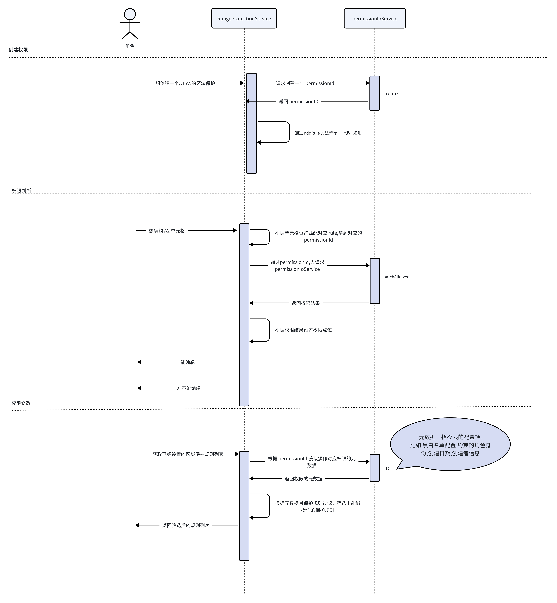

import { PermissionShadowDemo } from './components/permission-shadow-demo'

用工作簿模式控制整份表格能否编辑或评论。要让指定协作者填写某张工作表或某个区域，给相应范围添加保护规则。多人协同时，服务端还需分别校验读取、加入会话和修改文档的权限，见[身份与权限](/server/collaboration/identity-and-authorization)。

## 常用任务 [#permission-tasks]

### 将工作簿设为只读或允许评论

`viewer` 模式允许查看和打印。要让用户可以评论，同时保持单元格只读，把上面的 `'viewer'` 换成 `'commenter'`。一个模式会一次性设置多个权限点位。要调整某位协作者的角色，请使用[协作者管理](#collaborators)中的 API。

```typescript
const fWorkbook = univerAPI.getActiveWorkbook()
if (!fWorkbook) throw new Error('No active workbook')
const permission = fWorkbook.getWorkbookPermission()
await permission.setMode('viewer')
```

只修改一个权限点位时，调用 `setPoint`。例如，关闭工作簿编辑权限可以使用 `await permission.setPoint(univerAPI.Enum.WorkbookPermissionPoint.Edit, false)`。点位值发生变化时，SDK 会调用 `IAuthzIoService.update`。传入 `true` 时，发送给服务的策略角色是 `Editor`，传入 `false` 时是 `Owner`。要在重新打开文档后保留设置，请[接入权限服务](#authorization-service)。

<PlaygroundFrame lang="zh-CN" slug="sheets/permission" clickToShow />

### 允许指定协作者编辑工作表

将 `user1` 和 `user2` 替换为这份工作簿已有协作者的 ID。要设置单个工作表权限点位，先用 `protect()` 创建保护规则。要解除整张工作表的保护，调用 `worksheetPermission.unprotect()`。

```typescript
const fWorkbook = univerAPI.getActiveWorkbook()
if (!fWorkbook) throw new Error('No active workbook')
const fWorksheet = fWorkbook.getActiveSheet()
const worksheetPermission = fWorksheet.getWorksheetPermission()

await worksheetPermission.protect({
  allowedUsers: ['user1', 'user2'],
  name: 'My Worksheet Protection',
})
```

### 只允许指定协作者查看和编辑 A1:B2

`allowedUsers` 指定可编辑该区域的协作者。`allowViewByOthers: false` 同时限制其他人的查看权限。稍后可用返回的 `rule.remove()` 单独移除这条规则。

```typescript
const fWorkbook = univerAPI.getActiveWorkbook()
if (!fWorkbook) throw new Error('No active workbook')
const fWorksheet = fWorkbook.getActiveSheet()
const fRange = fWorksheet.getRange('A1:B2')
const rangePermission = fRange.getRangePermission()

const rule = await rangePermission.protect({
  name: 'My protected range',
  allowViewByOthers: false,
  allowedUsers: ['user1', 'user2'],
})
```

要列出与该选区相交的规则，调用 `rangePermission.listRules()`。`rangePermission.unprotect()` 会移除所有相交的规则。

### 管理保护范围

```typescript
const fWorkbook = univerAPI.getActiveWorkbook()
if (!fWorkbook) throw new Error('No active workbook')
const fWorksheet = fWorkbook.getActiveSheet()
const permission = fWorksheet.getWorksheetPermission()

const createdRules = await permission.protectRanges([
  {
    ranges: [fWorksheet.getRange('D1:D4')],
    options: { name: 'Public area', allowViewByOthers: true },
  },
  {
    ranges: [fWorksheet.getRange('E1:E4')],
    options: { name: 'Private area', allowViewByOthers: false, allowedUsers: ['user1'] },
  },
])

await createdRules[0].updateRanges([fWorksheet.getRange('D1:D5')])
```

### 排查为什么 A1 无法输入

下面的示例列出输入普通单元格值所需的权限。任何一项为 `false` 都会阻止输入。`debugCellPermission(0, 0)` 返回覆盖 A1 的保护规则，没有匹配规则时返回 `undefined`。

```typescript
const fWorkbook = univerAPI.getActiveWorkbook()
if (!fWorkbook) throw new Error('No active workbook')
const worksheet = fWorkbook.getActiveSheet().getWorksheetPermission()
const rule = await worksheet.debugCellPermission(0, 0)

console.table({
  workbookEdit: fWorkbook.getWorkbookPermission().canEdit(),
  worksheetEdit: worksheet.canEdit(),
  setCellValue: worksheet.getPoint(univerAPI.Enum.WorksheetPermissionPoint.SetCellValue),
  rangeEdit: rule?.canEdit() ?? true,
})
```

## 权限点位列表 [#point-list]

### 工作表操作及其权限点位

每个操作都检查自己的一组权限点位。工作簿点位与同一行列出的 worksheet、range 点位同时生效。如果某一行包含区域点位，操作涉及的每个保护规则也必须允许该编辑。隐藏行或列时，检查范围会扩展到整行或整列。

| 操作 | 需要的权限点位 |
| --- | --- |
| 写入单元格值（不含公式） | `WorkbookEditablePermission`、`WorksheetEditPermission`、`WorksheetSetCellValuePermission`、`RangeProtectionPermissionEditPoint` |
| 插入工作表 | `WorkbookEditablePermission`、`WorkbookCreateSheetPermission` |
| 复制工作表 | `WorkbookEditablePermission`、`WorkbookCopySheetPermission` |
| 移动工作表 | `WorkbookEditablePermission`、`WorkbookMoveSheetPermission` |
| 重命名工作表 | `WorkbookEditablePermission`、`WorkbookRenameSheetPermission` |
| 隐藏或显示工作表 | `WorkbookEditablePermission`、`WorkbookHideSheetPermission` |
| 删除工作表 | `WorkbookEditablePermission`、`WorkbookDeleteSheetPermission` |
| 隐藏或显示行或列 | `WorkbookEditablePermission`、`WorksheetEditPermission`、`WorksheetSetRowStylePermission` 或 `WorksheetSetColumnStylePermission`，以及每个相交保护规则的编辑点位 |
| 调整行高或列宽，或按内容自适应 | `WorksheetSetRowStylePermission` 或 `WorksheetSetColumnStylePermission` |
| 合并或取消合并单元格 | `WorkbookEditablePermission`、`WorksheetEditPermission`、`WorksheetSetCellValuePermission`、`WorksheetSetCellStylePermission`，以及每个相交保护规则的编辑点位 |
| 对区域排序 | `WorkbookEditablePermission`、`WorksheetEditPermission`、`WorksheetSortPermission`，以及每个相交保护规则的编辑点位 |
| 冻结或取消冻结窗格 | `WorkbookEditablePermission`、`WorksheetEditPermission` |
| 显示或隐藏网格线，或修改网格线颜色 | `WorkbookEditablePermission`、`WorksheetEditPermission` |
| 添加、更新或删除批注 | `WorkbookEditablePermission`、`WorksheetEditPermission`，以及批注所在单元格相交的每个保护规则的编辑点位 |
| 组合或取消组合行或列 | `WorkbookEditablePermission`、`WorksheetEditPermission`、`WorksheetSetRowStylePermission` 或 `WorksheetSetColumnStylePermission`，以及每个相交保护规则的编辑点位 |
| 创建保护规则 | `WorkbookCreateProtectPermission` |
| 管理保护规则的协作者 | `WorksheetManageCollaboratorPermission` 或 `RangeProtectionPermissionManageCollaPoint` |
| 删除保护规则 | `WorksheetDeleteProtectionPermission` 或 `RangeProtectionPermissionDeleteProtectionPoint` |

任一必需点位为 `false` 时，命令会在执行变更之前被拒绝，文档不会发生变化。

批注遵循单元格的编辑点位，读取批注不检查权限。

### 评论权限

读取表格评论需要工作簿的 `View`，发表评论需要工作簿的 `Comment`。两者都需要工作表的 `View`。评论锚定在单元格上时，还会检查覆盖该单元格的保护规则是否允许查看。作者可以修改或删除自己的评论。

### 工作簿 [#workbook-point]

| API 枚举 | 对应权限点位类 | 描述 |
| --- | --- | --- |
| univerAPI.Enum.WorkbookPermissionPoint.Edit | WorkbookEditablePermission | 能否编辑 |
| univerAPI.Enum.WorkbookPermissionPoint.View | WorkbookViewPermission | 能否查看 |
| univerAPI.Enum.WorkbookPermissionPoint.Print | WorkbookPrintPermission | 能否打印 |
| univerAPI.Enum.WorkbookPermissionPoint.Export | WorkbookExportPermission | 能否导出 |
| univerAPI.Enum.WorkbookPermissionPoint.Share | WorkbookSharePermission | 能否分享 |
| univerAPI.Enum.WorkbookPermissionPoint.CopyContent | WorkbookCopyPermission | 能否复制 |
| univerAPI.Enum.WorkbookPermissionPoint.DuplicateFile | WorkbookDuplicatePermission | 能否复制文档 |
| univerAPI.Enum.WorkbookPermissionPoint.Comment | WorkbookCommentPermission | 能否评论 |
| univerAPI.Enum.WorkbookPermissionPoint.ManageCollaborator | WorkbookManageCollaboratorPermission | 能否管理协作者 |
| univerAPI.Enum.WorkbookPermissionPoint.CreateSheet | WorkbookCreateSheetPermission | 能否创建工作表 |
| univerAPI.Enum.WorkbookPermissionPoint.DeleteSheet | WorkbookDeleteSheetPermission | 能否删除工作表 |
| univerAPI.Enum.WorkbookPermissionPoint.RenameSheet | WorkbookRenameSheetPermission | 能否重命名工作表 |
| univerAPI.Enum.WorkbookPermissionPoint.MoveSheet | WorkbookMoveSheetPermission | 能否移动工作表 |
| univerAPI.Enum.WorkbookPermissionPoint.HideSheet | WorkbookHideSheetPermission | 能否隐藏工作表 |
| univerAPI.Enum.WorkbookPermissionPoint.CopySheet | WorkbookCopySheetPermission | 能否复制工作表 |
| univerAPI.Enum.WorkbookPermissionPoint.ViewHistory | WorkbookViewHistoryPermission | 能否查看历史记录 |
| univerAPI.Enum.WorkbookPermissionPoint.RecoverHistory | WorkbookRecoverHistoryPermission | 能否恢复历史记录 |
| univerAPI.Enum.WorkbookPermissionPoint.CreateProtection | WorkbookCreateProtectPermission | 能否创建保护 |
| univerAPI.Enum.WorkbookPermissionPoint.InsertRow | WorkbookInsertRowPermission | 能否插入行 |
| univerAPI.Enum.WorkbookPermissionPoint.InsertColumn | WorkbookInsertColumnPermission | 能否插入列 |
| univerAPI.Enum.WorkbookPermissionPoint.DeleteRow | WorkbookDeleteRowPermission | 能否删除行 |
| univerAPI.Enum.WorkbookPermissionPoint.DeleteColumn | WorkbookDeleteColumnPermission | 能否删除列 |

### 工作表 [#worksheet-point]

| API 枚举 | 对应权限点位类 | 描述 |
| --- | --- | --- |
| univerAPI.Enum.WorksheetPermissionPoint.Edit | WorksheetEditPermission | 能否编辑 |
| univerAPI.Enum.WorksheetPermissionPoint.View | WorksheetViewPermission | 能否查看 |
| univerAPI.Enum.WorksheetPermissionPoint.Copy | WorksheetCopyPermission | 能否复制 |
| univerAPI.Enum.WorksheetPermissionPoint.SetCellValue | WorksheetSetCellValuePermission | 能否编辑单元格值 |
| univerAPI.Enum.WorksheetPermissionPoint.SetCellStyle | WorksheetSetCellStylePermission | 能否编辑单元格样式 |
| univerAPI.Enum.WorksheetPermissionPoint.SetRowStyle | WorksheetSetRowStylePermission | 能否设置行样式 |
| univerAPI.Enum.WorksheetPermissionPoint.SetColumnStyle | WorksheetSetColumnStylePermission | 能否设置列样式 |
| univerAPI.Enum.WorksheetPermissionPoint.InsertRow | WorksheetInsertRowPermission | 能否插入行 |
| univerAPI.Enum.WorksheetPermissionPoint.InsertColumn | WorksheetInsertColumnPermission | 能否插入列 |
| univerAPI.Enum.WorksheetPermissionPoint.DeleteRow | WorksheetDeleteRowPermission | 能否删除行 |
| univerAPI.Enum.WorksheetPermissionPoint.DeleteColumn | WorksheetDeleteColumnPermission | 能否删除列 |
| univerAPI.Enum.WorksheetPermissionPoint.Sort | WorksheetSortPermission | 能否排序 |
| univerAPI.Enum.WorksheetPermissionPoint.Filter | WorksheetFilterPermission | 能否筛选 |
| univerAPI.Enum.WorksheetPermissionPoint.PivotTable | WorksheetPivotTablePermission | 能否使用透视表 |
| univerAPI.Enum.WorksheetPermissionPoint.InsertHyperlink | WorksheetInsertHyperlinkPermission | 能否使用超链接 |
| univerAPI.Enum.WorksheetPermissionPoint.ManageCollaborator | WorksheetManageCollaboratorPermission | 能否管理协作者 |
| univerAPI.Enum.WorksheetPermissionPoint.DeleteProtection | WorksheetDeleteProtectionPermission | 能否删除保护 |
| univerAPI.Enum.WorksheetPermissionPoint.EditExtraObject | WorksheetEditExtraObjectPermission | 能否编辑额外对象 |
| univerAPI.Enum.WorksheetPermissionPoint.SelectProtectedCells | WorksheetSelectProtectedCellsPermission | 能否选择受保护单元格 |
| univerAPI.Enum.WorksheetPermissionPoint.SelectUnProtectedCells | WorksheetSelectUnProtectedCellsPermission | 能否选择未受保护单元格 |

### 区域保护 [#range-point]

| API 枚举 | 对应权限点位类 | 描述 |
| --- | --- | --- |
| univerAPI.Enum.RangePermissionPoint.Edit | RangeProtectionPermissionEditPoint | 能否编辑保护区域 |
| univerAPI.Enum.RangePermissionPoint.View | RangeProtectionPermissionViewPoint | 能否查看保护区域的内容 |
| univerAPI.Enum.RangePermissionPoint.Delete | RangeProtectionPermissionDeleteProtectionPoint | 能否删除保护区域 |
| univerAPI.Enum.RangePermissionPoint.ManageCollaborator | RangeProtectionPermissionManageCollaPoint | 能否管理保护区域的协作者 |

## 插件配置 [#plugin-configuration]

`UniverSheetsUIPlugin`

| <span data-config-options="">配置项</span> | 类型 | 默认值 | 作用 |
| --- | --- | --- | --- |
| `protectedRangeShadow` | `boolean \| 'always' \| 'non-editable' \| 'non-viewable' \| 'none'` | `true` | 哪些受保护区域显示阴影。 |
| <ConfigKey depth={0}>protectedRangeUserSelector</ConfigKey> | `object` |  | 自定义选择保护区域用户的选择器。 |
| <ConfigKey depth={1}>component</ConfigKey> | `ComponentType<IPermissionDetailUserPartProps>` |  | 用于选择用户的组件。 |
| <ConfigKey depth={1}>framework</ConfigKey> | `string` |  | 组件所使用的框架，例如 `react`。 |

## 预设配置 [#preset-configuration]

`UniverSheetsCorePreset`

| <span data-config-options="">配置项</span> | 类型 | 默认值 | 作用 |
| --- | --- | --- | --- |
| <ConfigKey depth={0}>sheets</ConfigKey> | `object` |  | 所选功能的配置项。 |
| <ConfigKey depth={1}>protectedRangeShadow</ConfigKey> | `boolean \| 'always' \| 'non-editable' \| 'non-viewable' \| 'none'` | `true` | 哪些受保护区域显示阴影。 |
| <ConfigKey depth={1}>protectedRangeUserSelector</ConfigKey> | `object` |  | 自定义选择保护区域用户的选择器。 |
| <ConfigKey depth={2}>component</ConfigKey> | `ComponentType<IPermissionDetailUserPartProps>` |  | 用于选择用户的组件。 |
| <ConfigKey depth={2}>framework</ConfigKey> | `string` |  | 组件所使用的框架，例如 `react`。 |

## 权限保护范围阴影策略 [#permission-ui]

如需区分当前用户可以编辑和不能编辑的保护区域，使用 `non-editable`。可编辑的区域不显示阴影，编辑被禁用的区域保留阴影，不可查看的区域继续遮罩。

该设置只影响范围保护和工作表保护的显示方式：它不会创建保护规则，不会修改编辑、查看权限，也不会为未受保护的区域添加阴影。请先按上文配置好保护规则和当前用户的权限。

| 策略 | 显示效果 |
| --- | --- |
| `true` / `'always'` | 显示所有保护区域的阴影（默认）。 |
| `'non-editable'` | 隐藏可编辑保护区域的阴影，保留不可编辑区域的阴影。 |
| `'non-viewable'` | 仅显示不可查看保护区域的阴影。 |
| `false` / `'none'` | 隐藏全部保护阴影，权限检查仍然生效。 |

<PermissionShadowDemo />

初始化时设置：

<Tabs items={['插件模式', '预设模式']}>
  <Tab>
    ```typescript
    univer.registerPlugin(UniverSheetsUIPlugin, {
      protectedRangeShadow: 'non-editable',
    })
    ```
  </Tab>
  <Tab>
    ```typescript
    createUniver({
      presets: [
        UniverSheetsCorePreset({
          sheets: {
            protectedRangeShadow: 'non-editable',
          },
        }),
      ],
    })
    ```
  </Tab>
</Tabs>

## 自定义用户组件

内置的用户选择器适用的场景有限。如果业务场景有更多需求，可以提供自定义组件：

<Callout>
  自定义组件的实现方式见[自定义组件](/guides/sheets/ui/components)。
</Callout>

<Tabs items={['插件模式', '预设模式']}>
  <Tab>
    ```typescript
    univer.registerPlugin(UniverSheetsUIPlugin, {
      protectedRangeUserSelector: {
        /**
         * custom component, should implement the `IPermissionDetailUserPartProps` interface.
         */
        component: CustomPermissionDetailUserPart,
        /**
         * The framework of the component. Must be passed correctly.
         */
        framework: 'react',
      },
    })
    ```
  </Tab>
  <Tab>
    ```typescript
    const { univer } = createUniver({
      presets: [
        UniverSheetsCorePreset({
          sheets: {
            protectedRangeUserSelector: {
            /**
             * custom component, should implement the `IPermissionDetailUserPartProps` interface.
             */
              component: CustomPermissionDetailUserPart,
              /**
               * The framework of the component. Must be passed correctly.
               */
              framework: 'react',
            },
          },
        }),
      ],
    })
    ```
  </Tab>
</Tabs>

## 用 Facade API 更新权限界面 [#permission-ui-api]

### 权限保护范围阴影策略 [#protected-range-shadow-api]

下面的 Facade API 修改的是当前 Univer 实例中已有工作簿的显示策略。插件模式下需要先导入 `@univerjs/sheets-ui/facade`；Sheets Core 预设已经包含该模块。

```typescript
// 设置只显示不可编辑范围的阴影
univerAPI.setProtectedRangeShadowStrategy('non-editable')

// 获取当前的权限保护范围阴影显示策略
console.log(univerAPI.getProtectedRangeShadowStrategy())

// 监听权限保护范围阴影显示策略的变化
const subscription = univerAPI.getProtectedRangeShadowStrategy$().subscribe((strategy) => {
  console.log('Global strategy changed to:', strategy)
  // 更新 UI 或执行其他操作
})

// 稍后，取消订阅以进行清理
subscription.unsubscribe()
```

### 自定义用户组件 [#permission-user-picker-api]

在用户选择器的变更回调中调用 `setSelectUserList()`。下面的 React 示例只完成一件事：清空已选用户。`useDependency` 在组件内部调用，服务状态在点击之后才更新。选择器的其余部分按 `IPermissionDetailUserPartProps` 实现。

<Tabs items={['插件模式', '预设模式']}>
  <Tab>
    ```tsx
    import type { IPermissionDetailUserPartProps } from '@univerjs/sheets-ui'
    import type { FC } from 'react'
    import { SheetPermissionUserManagerService } from '@univerjs/sheets-ui'
    import { useDependency } from '@univerjs/ui'

    export const CustomPermissionDetailUserPart: FC<IPermissionDetailUserPartProps> = () => {
      const service = useDependency(SheetPermissionUserManagerService)
      const clearSelection = () => service.setSelectUserList([])

      return <button type="button" onClick={clearSelection}>清空已选用户</button>
    }
    ```
  </Tab>
  <Tab>
    ```tsx
    import type { IPermissionDetailUserPartProps } from '@univerjs/preset-sheets-core'
    import type { FC } from 'react'
    import { SheetPermissionUserManagerService, useDependency } from '@univerjs/preset-sheets-core'

    export const CustomPermissionDetailUserPart: FC<IPermissionDetailUserPartProps> = () => {
      const service = useDependency(SheetPermissionUserManagerService)
      const clearSelection = () => service.setSelectUserList([])

      return <button type="button" onClick={clearSelection}>清空已选用户</button>
    }
    ```
  </Tab>
</Tabs>

### 去除权限弹窗

```typescript
univerAPI.setPermissionDialogVisible(false)
```

## 权限服务接入 [#permission-integration]

### 第三方权限服务接入(进阶用法) [#authorization-service]

在创建工作簿前注册 [`IAuthzIoService`](https://github.com/dream-num/univer/blob/v1.6.0/packages/core/src/services/authz-io/type.ts) 的实现。服务需保存保护规则和协作者变更，按当前用户返回权限，并将请求错误返回给调用方。

```typescript
import { IAuthzIoService, Univer } from '@univerjs/core'
import { YourAuthzService } from './authorization-service'

const univer = new Univer({
  override: [[IAuthzIoService, { useClass: YourAuthzService }]],
})
```



### 协作者管理 [#collaborators]

- 获取协作者列表

```typescript
const fWorkbook = univerAPI.getActiveWorkbook()
if (!fWorkbook) throw new Error('No active workbook')
const workbookPermission = fWorkbook.getWorkbookPermission()

const collaborators = await workbookPermission.listCollaborators()
console.log(collaborators)
```

- 添加协作者

`addCollaborator` 添加一人。`setCollaborators` 替换完整名单，调用时请包含所有仍需保留的协作者。

```typescript
const fWorkbook = univerAPI.getActiveWorkbook()
if (!fWorkbook) throw new Error('No active workbook')
const workbookPermission = fWorkbook.getWorkbookPermission()

await workbookPermission.addCollaborator(
  { userID: 'user1', name: 'John Doe', avatar: '' },
  univerAPI.Enum.UnitRole.Editor,
)
```

- 替换协作者名单

```typescript
const fWorkbook = univerAPI.getActiveWorkbook()
if (!fWorkbook) throw new Error('No active workbook')
const workbookPermission = fWorkbook.getWorkbookPermission()

await workbookPermission.setCollaborators([
  {
    user: { userID: 'user1', name: 'John Doe', avatar: '' },
    role: univerAPI.Enum.UnitRole.Editor,
  },
  {
    user: { userID: 'user2', name: 'Jane Smith', avatar: '' },
    role: univerAPI.Enum.UnitRole.Reader,
  },
])
```

- 更新协作者角色

```typescript
const fWorkbook = univerAPI.getActiveWorkbook()
if (!fWorkbook) throw new Error('No active workbook')
const workbookPermission = fWorkbook.getWorkbookPermission()

await workbookPermission.updateCollaborator(
  { userID: 'user1', name: 'John Doe Updated', avatar: '' },
  univerAPI.Enum.UnitRole.Reader,
)
```

- 删除协作者

```typescript
const fWorkbook = univerAPI.getActiveWorkbook()
if (!fWorkbook) throw new Error('No active workbook')
const workbookPermission = fWorkbook.getWorkbookPermission()

await workbookPermission.removeCollaborators(['user1', 'user2'])
```

## 在插件中扩展权限

### 拓展使用

如需在自己的插件中校验权限，可直接操作权限点位。

下面以 `WorkbookEditablePermission` 为例，其他权限点位的用法相同：

```typescript
import { IPermissionService } from '@univerjs/core'
import { WorkbookEditablePermission } from '@univerjs/sheets'

class YourService {
  constructor(@IPermissionService private _permissionService: IPermissionService) {
  }

  setWorkbookNotEditable() {
    this._permissionService.updatePermissionPoint(new WorkbookEditablePermission('unitId').id, false)
  }

  setWorkbookEditable() {
    this._permissionService.updatePermissionPoint(new WorkbookEditablePermission('unitId').id, true)
  }
}
```

[权限点位列表](#point-list)

`SheetPermissionCheckController.permissionCheckByPoints(points)` 检查显式传入的权限点位列表，只要其中任一点位被禁用就返回 `false`。当命令已经知道所需点位时，例如某个具体保护规则的点位，可以使用该方法。

### 第三方插件如何扩展权限点位

自定义权限点位需要实现 `IPermissionPoint` 并注册到权限服务中：

```typescript
import type { IPermissionPoint } from '@univerjs/core'
import { IPermissionService, PermissionStatus } from '@univerjs/core'
import { UnitAction, UnitObject } from '@univerjs/protocol'

export class CustomPermissionPoint implements IPermissionPoint {
  type = UnitObject.Unkonwn // your type
  subType = UnitAction.View // your subType
  status = PermissionStatus.INIT
  value = true // 权限的初始值
  id: string
  constructor(unitId: string, subUnitId: string, customId: string) {
    // 这里自行拼凑一个 id，id 属性需要保证在整个 IPermissionService 中是唯一的凭证。
    this.id = `${unitId}.${subUnitId}.${customId}`
  }
}

class YourService {
  constructor(@IPermissionService private _permissionService: IPermissionService) {
    this._init()
  }

  _init() {
    this._permissionService.addPermissionPoint(new CustomPermissionPoint('unitId', 'subUnitId', 'my-id'))
  }
}

// 在其他地方如何使用
class ConsumeService {
  constructor(@IPermissionService private _permissionService: IPermissionService) {
  }

  doSomething() {
    const point = this._permissionService.getPermissionPoint(new CustomPermissionPoint('unitId', 'subUnitId', 'my-id').id)
    console.log(point?.value)
  }

  bindEvent() {
    // 这将获得一个 Rx 对象，使得你能够监听当前权限的变化作出一些改变
    const point$ = this._permissionService.getPermissionPoint$(new CustomPermissionPoint('unitId', 'subUnitId', 'my-id').id)
    console.log(point$)
  }
}
```

## Reference

- [FWorkbookPermission](/reference/facade/workbook-permission)
- [FWorksheetPermission](/reference/facade/worksheet-permission)
- [FRangePermission](/reference/facade/range-permission)
- [FRangeProtectionRule](/reference/facade/range-protection-rule)
