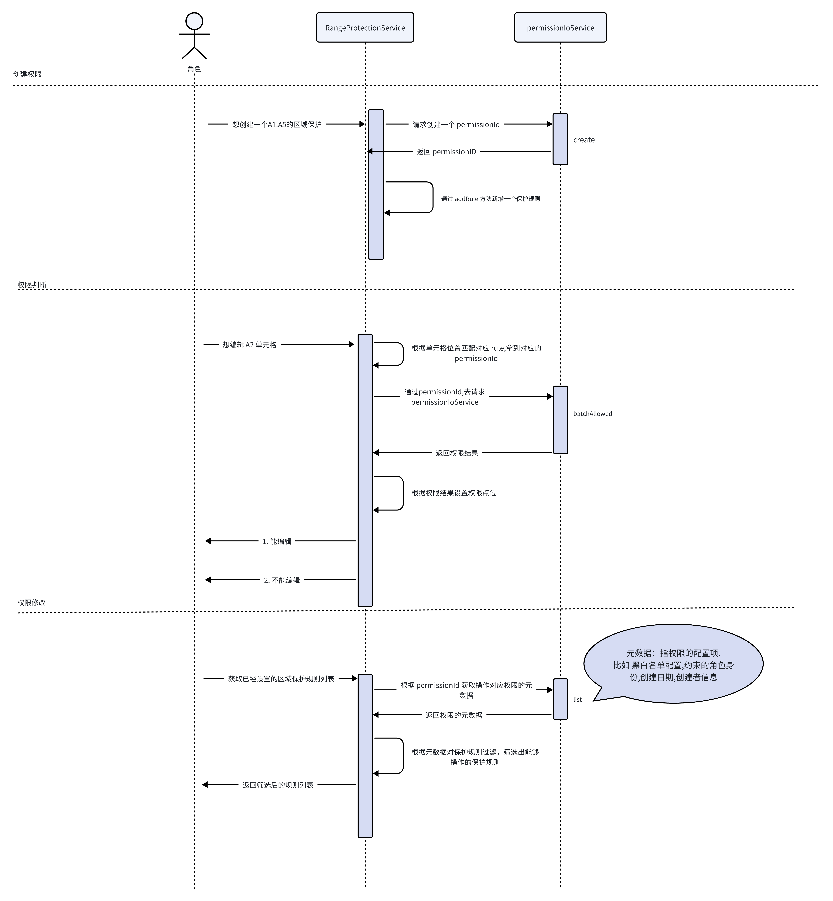

import { PermissionShadowDemo } from './components/permission-shadow-demo'

Univer 的權限控制決定使用者可以對工作簿、工作表和選區執行哪些操作。使用者執行缺少所需權限的操作時，Univer 會中止該操作並提示缺少的權限。為選區新增保護後，即可控制協作者在該選區內能否編輯、檢視、複製和篩選。

<Callout type="warning">
業務服務必須持久化保護規則和協作者變更，返回當前使用者的權限，並把請求失敗傳遞給呼叫方。返回空列表的 mock 不是持久化實現。協同場景下，後端還必須自行校驗讀取、JOIN 和修改權限，見[身分與權限](/server/collaboration/identity-and-authorization)。前端的保護與陰影隱藏不能替代伺服器端鑑權。

[權限服務整合](#authorization-service)
</Callout>

<PlaygroundFrame lang="zh-TW" slug="sheets/permission" clickToShow />

本頁覆蓋基礎操作、進階範例、配置和故障排查；完整的 API 定義統一收錄在 Reference。

- [常用任務](#permission-tasks)
- [權限介面設定](#permission-ui)
- [權限服務整合](#permission-integration)
- [Reference](#reference)

## 核心概念

- 作用範圍：權限作用於工作簿、工作表、選區三個層級。
- 權限點位：每個功能對應一個權限點位，改變點位的值即可啟用或停用該功能。
- 保護規則：工作表或選區必須先建立保護規則，才能設定其權限點位。

<Callout type="info">
本地非持久化的權限可以直接透過權限點位修改；如需持久化，見 [權限服務接入](#authorization-service)。

協同編輯時，更新權限點位會同步更新伺服器端狀態：
  - false：該權限點至少需要 `owner` 角色
  - true：該權限點至少需要 `reader` 角色
</Callout>

## 基礎示例

使用 `allowedUsers` 的範例之前，請先把 `user1`、`user2` 替換為權限服務返回的真實協作者 ID。

下面按工作簿、工作表、選區三個層級，說明最常用的權限設定方式。

### 工作簿權限程式碼示例

工作簿層級的權限直接透過 [Facade API](/guides/sheets/getting-started/facade) 設定。

下面的範例關閉整個工作簿的編輯權限。如需控制其他功能，替換為對應的權限點位，見[權限點位列表 - 工作簿](#workbook-point)：

```typescript
const fWorkbook = univerAPI.getActiveWorkbook()
if (!fWorkbook) throw new Error('No active workbook')
const workbookPermission = fWorkbook.getWorkbookPermission()

// 設定工作簿不可編輯
await workbookPermission.setPoint(univerAPI.Enum.WorkbookPermissionPoint.Edit, false)
```

工作簿權限點位可以直接設定，不需要先建立保護規則。

### 工作表權限程式碼示例

工作表和選區的權限可以透過 Facade API 設定，也可以透過命令設定。下面以工作表編輯權限為例；如需控制其他功能，替換為對應的權限點位，見[權限點位列表 - 工作表](#worksheet-point)。

```typescript
const fWorkbook = univerAPI.getActiveWorkbook()
if (!fWorkbook) throw new Error('No active workbook')
const fWorksheet = fWorkbook.getActiveSheet()
const worksheetPermission = fWorksheet.getWorksheetPermission()

// 建立工作表保護, 允許指定使用者編輯
const permissionId = await worksheetPermission.protect({
  allowedUsers: ['user1', 'user2'],
  name: 'My Worksheet Protection',
})

// 如果需要設定權限點位，必須先建立工作表保護
await worksheetPermission.setPoint(univerAPI.Enum.WorksheetPermissionPoint.Edit, false)
```

#### 刪除工作表權限

```typescript
const fWorkbook = univerAPI.getActiveWorkbook()
if (!fWorkbook) throw new Error('No active workbook')
const fWorksheet = fWorkbook.getActiveSheet()
const worksheetPermission = fWorksheet.getWorksheetPermission()

// 刪除工作表保護
await worksheetPermission.unprotect()
```

### 自訂選區權限程式碼示例

選區的權限同樣可以透過 API 和命令兩種方式設定。下面以選區編輯權限為例；其他選區功能需要替換權限點位，見[權限點位列表 - 選區](#range-point)。

```typescript
const fWorkbook = univerAPI.getActiveWorkbook()
if (!fWorkbook) throw new Error('No active workbook')
const fWorksheet = fWorkbook.getActiveSheet()
const fRange = fWorksheet.getRange('A1:B2')
const rangePermission = fRange.getRangePermission()

// 設定區域保護權限，允許指定使用者編輯但不允許他人檢視
const rule = await rangePermission.protect({
  name: 'My protected range',
  allowViewByOthers: false,
  allowedUsers: ['user1', 'user2'],
})
console.log(rule)

// 如果需要設定權限點位，必須先建立區域保護
await rule.setPoint(univerAPI.Enum.RangePermissionPoint.Edit, false)
await rule.setPoint(univerAPI.Enum.RangePermissionPoint.View, true)
```

#### 刪除區域保護權限

```typescript
const fWorkbook = univerAPI.getActiveWorkbook()
if (!fWorkbook) throw new Error('No active workbook')
const fWorksheet = fWorkbook.getActiveSheet()
const fRange = fWorksheet.getRange('A1:B2')
const rangePermission = fRange.getRangePermission()

// 刪除區域内所有保護規則
await rangePermission.unprotect()

// 或刪除區域内指定規則
const rules = await rangePermission.listRules()
if (rules.length > 0) {
  await rules[0].remove()
}
```

## 常用任務 [#permission-tasks]

### 將活頁簿設為唯讀

```typescript
const fWorkbook = univerAPI.getActiveWorkbook()
if (!fWorkbook) throw new Error('No active workbook')
const permission = fWorkbook.getWorkbookPermission()
await permission.setMode('viewer')
console.log(permission.getSnapshot())
```

### 管理保護範圍

```typescript
const fWorkbook = univerAPI.getActiveWorkbook()
if (!fWorkbook) throw new Error('No active workbook')
const fWorksheet = fWorkbook.getActiveSheet()
const permission = fWorksheet.getWorksheetPermission()

const createdRules = await permission.protectRanges([
  {
    ranges: [fWorksheet.getRange('A1:B2')],
    options: { name: 'Public area', allowViewByOthers: true },
  },
  {
    ranges: [fWorksheet.getRange('C3:D4')],
    options: { name: 'Private area', allowViewByOthers: false, allowedUsers: ['user1'] },
  },
])
console.log(createdRules)

const rules = await permission.listRangeProtectionRules()
const firstRule = rules[0]
if (firstRule) {
  await firstRule.updateRanges([fWorksheet.getRange('A1:B3')])
}
```

### 排查儲存格權限

```typescript
const fWorkbook = univerAPI.getActiveWorkbook()
if (!fWorkbook) throw new Error('No active workbook')
const permission = fWorkbook.getActiveSheet().getWorksheetPermission()
console.log(permission.debugCellPermission(0, 0))
```

## 權限點位列表 [#point-list]

所有權限點位的原始碼在[這裡](https://github.com/dream-num/univer/tree/dev/packages/sheets/src/services/permission/permission-point)。

當某個功能同時受 `workbook` 權限和 `worksheet`、`range` 權限約束時，相關權限必須全部為 `true`，該功能才可用。例如，單元格的編輯權限要求 `workbook` 和 `worksheet` 的編輯權限都為 `true`。

### 工作簿 [#workbook-point]

| API 列舉 | 對應權限點位類 | 描述 |
| --- | --- | --- |
| univerAPI.Enum.WorkbookPermissionPoint.Edit | WorkbookEditablePermission | 能否編輯 |
| univerAPI.Enum.WorkbookPermissionPoint.View | WorkbookViewPermission | 能否檢視 |
| univerAPI.Enum.WorkbookPermissionPoint.Print | WorkbookPrintPermission | 能否列印 |
| univerAPI.Enum.WorkbookPermissionPoint.Export | WorkbookExportPermission | 能否匯出 |
| univerAPI.Enum.WorkbookPermissionPoint.Share | WorkbookSharePermission | 能否分享 |
| univerAPI.Enum.WorkbookPermissionPoint.CopyContent | WorkbookCopyPermission | 能否複製 |
| univerAPI.Enum.WorkbookPermissionPoint.DuplicateFile | WorkbookDuplicatePermission | 能否複製文件 |
| univerAPI.Enum.WorkbookPermissionPoint.Comment | WorkbookCommentPermission | 能否評論 |
| univerAPI.Enum.WorkbookPermissionPoint.ManageCollaborator | WorkbookManageCollaboratorPermission | 能否管理協作者 |
| univerAPI.Enum.WorkbookPermissionPoint.CreateSheet | WorkbookCreateSheetPermission | 能否建立工作表 |
| univerAPI.Enum.WorkbookPermissionPoint.DeleteSheet | WorkbookDeleteSheetPermission | 能否刪除工作表 |
| univerAPI.Enum.WorkbookPermissionPoint.RenameSheet | WorkbookRenameSheetPermission | 能否重新命名工作表 |
| univerAPI.Enum.WorkbookPermissionPoint.MoveSheet | WorkbookMoveSheetPermission | 能否移動工作表 |
| univerAPI.Enum.WorkbookPermissionPoint.HideSheet | WorkbookHideSheetPermission | 能否隱藏工作表 |
| univerAPI.Enum.WorkbookPermissionPoint.CopySheet | WorkbookCopySheetPermission | 能否複製工作表 |
| univerAPI.Enum.WorkbookPermissionPoint.ViewHistory | WorkbookViewHistoryPermission | 能否檢視歷史記錄 |
| univerAPI.Enum.WorkbookPermissionPoint.RecoverHistory | WorkbookRecoverHistoryPermission | 能否恢復歷史記錄 |
| univerAPI.Enum.WorkbookPermissionPoint.CreateProtection | WorkbookCreateProtectPermission | 能否建立保護 |
| univerAPI.Enum.WorkbookPermissionPoint.InsertRow | WorkbookInsertRowPermission | 能否插入行 |
| univerAPI.Enum.WorkbookPermissionPoint.InsertColumn | WorkbookInsertColumnPermission | 能否插入列 |
| univerAPI.Enum.WorkbookPermissionPoint.DeleteRow | WorkbookDeleteRowPermission | 能否刪除行 |
| univerAPI.Enum.WorkbookPermissionPoint.DeleteColumn | WorkbookDeleteColumnPermission | 能否刪除列 |

### 工作表 [#worksheet-point]

| API 列舉 | 對應權限點位類 | 描述 |
| --- | --- | --- |
| univerAPI.Enum.WorksheetPermissionPoint.Edit | WorksheetEditPermission | 能否編輯 |
| univerAPI.Enum.WorksheetPermissionPoint.View | WorksheetViewPermission | 能否檢視 |
| univerAPI.Enum.WorksheetPermissionPoint.Copy | WorksheetCopyPermission | 能否複製 |
| univerAPI.Enum.WorksheetPermissionPoint.SetCellValue | WorksheetSetCellValuePermission | 能否編輯單元格值 |
| univerAPI.Enum.WorksheetPermissionPoint.SetCellStyle | WorksheetSetCellStylePermission | 能否編輯單元格樣式 |
| univerAPI.Enum.WorksheetPermissionPoint.SetRowStyle | WorksheetSetRowStylePermission | 能否設定行樣式 |
| univerAPI.Enum.WorksheetPermissionPoint.SetColumnStyle | WorksheetSetColumnStylePermission | 能否設定列樣式 |
| univerAPI.Enum.WorksheetPermissionPoint.InsertRow | WorksheetInsertRowPermission | 能否插入行 |
| univerAPI.Enum.WorksheetPermissionPoint.InsertColumn | WorksheetInsertColumnPermission | 能否插入列 |
| univerAPI.Enum.WorksheetPermissionPoint.DeleteRow | WorksheetDeleteRowPermission | 能否刪除行 |
| univerAPI.Enum.WorksheetPermissionPoint.DeleteColumn | WorksheetDeleteColumnPermission | 能否刪除列 |
| univerAPI.Enum.WorksheetPermissionPoint.Sort | WorksheetSortPermission | 能否排序 |
| univerAPI.Enum.WorksheetPermissionPoint.Filter | WorksheetFilterPermission | 能否篩選 |
| univerAPI.Enum.WorksheetPermissionPoint.PivotTable | WorksheetPivotTablePermission | 能否使用透視表 |
| univerAPI.Enum.WorksheetPermissionPoint.InsertHyperlink | WorksheetInsertHyperlinkPermission | 能否使用超連結 |
| univerAPI.Enum.WorksheetPermissionPoint.ManageCollaborator | WorksheetManageCollaboratorPermission | 能否管理協作者 |
| univerAPI.Enum.WorksheetPermissionPoint.DeleteProtection | WorksheetDeleteProtectionPermission | 能否刪除保護 |
| univerAPI.Enum.WorksheetPermissionPoint.EditExtraObject | WorksheetEditExtraObjectPermission | 能否編輯額外物件 |
| univerAPI.Enum.WorksheetPermissionPoint.SelectProtectedCells | WorksheetSelectProtectedCellsPermission | 能否選取受保護儲存格 |
| univerAPI.Enum.WorksheetPermissionPoint.SelectUnProtectedCells | WorksheetSelectUnProtectedCellsPermission | 能否選取未受保護儲存格 |

### 區域保護 [#range-point]

| API 列舉 | 對應權限點位類 | 描述 |
| --- | --- | --- |
| univerAPI.Enum.RangePermissionPoint.Edit | RangeProtectionPermissionEditPoint | 能否編輯保護區域 |
| univerAPI.Enum.RangePermissionPoint.View | RangeProtectionPermissionViewPoint | 能否檢視保護區域的內容 |
| univerAPI.Enum.RangePermissionPoint.Delete | RangeProtectionPermissionDeleteProtectionPoint | 能否刪除保護區域 |
| univerAPI.Enum.RangePermissionPoint.ManageCollaborator | RangeProtectionPermissionManageCollaPoint | 能否管理保護區域的協作者 |

## 外掛設定 [#plugin-configuration]

`UniverSheetsUIPlugin`

| <span data-config-options="">設定項目</span> | 類型 | 預設值 | 作用 |
| --- | --- | --- | --- |
| `protectedRangeShadow` | `boolean \| 'always' \| 'non-editable' \| 'non-viewable' \| 'none'` | `true` | 哪些受保護區域顯示陰影。 |
| <ConfigKey depth={0}>protectedRangeUserSelector</ConfigKey> | `object` |  | 自定義選擇保護區域使用者的選擇器。 |
| <ConfigKey depth={1}>component</ConfigKey> | `ComponentType<IPermissionDetailUserPartProps>` |  | 用於選取使用者的元件。 |
| <ConfigKey depth={1}>framework</ConfigKey> | `string` |  | 元件所使用的框架，例如 `react`。 |

## 預設設定 [#preset-configuration]

`UniverSheetsCorePreset`

| <span data-config-options="">設定項目</span> | 類型 | 預設值 | 作用 |
| --- | --- | --- | --- |
| <ConfigKey depth={0}>sheets</ConfigKey> | `object` |  | 所選功能的配置項。 |
| <ConfigKey depth={1}>protectedRangeShadow</ConfigKey> | `boolean \| 'always' \| 'non-editable' \| 'non-viewable' \| 'none'` | `true` | 哪些受保護區域顯示陰影。 |
| <ConfigKey depth={1}>protectedRangeUserSelector</ConfigKey> | `object` |  | 自定義選擇保護區域使用者的選擇器。 |
| <ConfigKey depth={2}>component</ConfigKey> | `ComponentType<IPermissionDetailUserPartProps>` |  | 用於選取使用者的元件。 |
| <ConfigKey depth={2}>framework</ConfigKey> | `string` |  | 元件所使用的框架，例如 `react`。 |

## 權限保護範圍陰影策略 [#permission-ui]

如需區分當前使用者可以編輯和不能編輯的保護區域，使用 `non-editable`。可編輯的區域不顯示陰影，編輯被禁用的區域保留陰影，不可檢視的區域繼續遮罩。

該設定隻影響範圍保護和工作表保護的顯示方式：它不會建立保護規則，不會修改編輯、檢視權限，也不會為未受保護的區域新增陰影。請先按上文配置好保護規則和當前使用者的權限。

| 策略 | 顯示效果 |
| --- | --- |
| `true` / `'always'` | 顯示所有保護區域的陰影（預設）。 |
| `'non-editable'` | 隱藏可編輯保護區域的陰影，保留不可編輯區域的陰影。 |
| `'non-viewable'` | 僅顯示不可檢視保護區域的陰影。 |
| `false` / `'none'` | 隱藏全部保護陰影，權限檢查仍然生效。 |

<PermissionShadowDemo />

初始化時設定：

<Tabs items={['外掛模式', '預設模式']}>
  <Tab>
    ```typescript
    univer.registerPlugin(UniverSheetsUIPlugin, {
      protectedRangeShadow: 'non-editable',
    })
    ```
  </Tab>
  <Tab>
    ```typescript
    createUniver({
      presets: [
        UniverSheetsCorePreset({
          sheets: {
            protectedRangeShadow: 'non-editable',
          },
        }),
      ],
    })
    ```
  </Tab>
</Tabs>

## 自訂使用者元件

內建的使用者選擇器適用的場景有限。如果業務場景有更多需求，可以提供自定義元件：

<Callout>
  自定義元件的實現方式見[自定義元件](/guides/sheets/ui/components)。
</Callout>

<Tabs items={['外掛模式', '預設模式']}>
  <Tab>
    ```typescript
    univer.registerPlugin(UniverSheetsUIPlugin, {
      protectedRangeUserSelector: {
        /**
         * custom component, should implement the `IPermissionDetailUserPartProps` interface.
         */
        component: CustomPermissionDetailUserPart,
        /**
         * The framework of the component. Must be passed correctly.
         */
        framework: 'react',
      },
    })
    ```
  </Tab>
  <Tab>
    ```typescript
    const { univer } = createUniver({
      presets: [
        UniverSheetsCorePreset({
          sheets: {
            protectedRangeUserSelector: {
            /**
             * custom component, should implement the `IPermissionDetailUserPartProps` interface.
             */
              component: CustomPermissionDetailUserPart,
              /**
               * The framework of the component. Must be passed correctly.
               */
              framework: 'react',
            },
          },
        }),
      ],
    })
    ```
  </Tab>
</Tabs>

## 用 Facade API 更新權限介面 [#permission-ui-api]

### 權限保護範圍陰影策略 [#protected-range-shadow-api]

下面的 Facade API 修改的是當前 Univer 例項中已有工作簿的顯示策略。外掛模式下需要先匯入 `@univerjs/sheets-ui/facade`；Sheets Core 預設已經包含該模組。

```typescript
// 設定只顯示不可編輯範圍的陰影
univerAPI.setProtectedRangeShadowStrategy('non-editable')

// 獲取當前的權限保護範圍陰影顯示策略
console.log(univerAPI.getProtectedRangeShadowStrategy())

// 監聽權限保護範圍陰影顯示策略的變化
const subscription = univerAPI.getProtectedRangeShadowStrategy$().subscribe((strategy) => {
  console.log('Global strategy changed to:', strategy)
  // 更新 UI 或執行其他操作
})

// 稍後，取消訂閱以進行清理
subscription.unsubscribe()
```

### 自訂使用者元件 [#permission-user-picker-api]

在使用者選擇器的變更回撥中呼叫 `setSelectUserList()`。下面的 React 範例只完成一件事：清空已選使用者。`useDependency` 在元件內部呼叫，服務狀態在點選之後才更新。選擇器的其餘部分按 `IPermissionDetailUserPartProps` 實現。

<Tabs items={['外掛模式', '預設模式']}>
  <Tab>
    ```tsx
    import type { IPermissionDetailUserPartProps } from '@univerjs/sheets-ui'
    import type { FC } from 'react'
    import { SheetPermissionUserManagerService } from '@univerjs/sheets-ui'
    import { useDependency } from '@univerjs/ui'

    export const CustomPermissionDetailUserPart: FC<IPermissionDetailUserPartProps> = () => {
      const service = useDependency(SheetPermissionUserManagerService)
      const clearSelection = () => service.setSelectUserList([])

      return <button type="button" onClick={clearSelection}>清空已選使用者</button>
    }
    ```
  </Tab>
  <Tab>
    ```tsx
    import type { IPermissionDetailUserPartProps } from '@univerjs/preset-sheets-core'
    import type { FC } from 'react'
    import { SheetPermissionUserManagerService, useDependency } from '@univerjs/preset-sheets-core'

    export const CustomPermissionDetailUserPart: FC<IPermissionDetailUserPartProps> = () => {
      const service = useDependency(SheetPermissionUserManagerService)
      const clearSelection = () => service.setSelectUserList([])

      return <button type="button" onClick={clearSelection}>清空已選使用者</button>
    }
    ```
  </Tab>
</Tabs>

### 去除權限彈窗

```typescript
univerAPI.setPermissionDialogVisible(false)
```

## 權限服務整合 [#permission-integration]

### 拓展使用

如需在自己的外掛中校驗權限，可直接操作權限點位。

下面以 `WorkbookEditablePermission` 為例，其他權限點位的用法相同：

```typescript
import { IPermissionService } from '@univerjs/core'
import { WorkbookEditablePermission } from '@univerjs/sheets'

class YourService {
  constructor(@IPermissionService private _permissionService: IPermissionService) {
  }

  setWorkbookNotEditable() {
    this._permissionService.updatePermissionPoint(new WorkbookEditablePermission('unitId').id, false)
  }

  setWorkbookEditable() {
    this._permissionService.updatePermissionPoint(new WorkbookEditablePermission('unitId').id, true)
  }
}
```

[權限點位列表](#point-list)

### 第三方外掛如何擴充權限點位

自定義權限點位需要實現 `IPermissionPoint` 並註冊到權限服務中：

```typescript
import type { IPermissionPoint } from '@univerjs/core'
import { IPermissionService, PermissionStatus } from '@univerjs/core'
import { UnitAction, UnitObject } from '@univerjs/protocol'

export class CustomPermissionPoint implements IPermissionPoint {
  type = UnitObject.Unkonwn // your type
  subType = UnitAction.View // your subType
  status = PermissionStatus.INIT
  value = true // 權限的初始值
  id: string
  constructor(unitId: string, subUnitId: string, customId: string) {
    // 這裡自行拼湊一個 id，id 屬性需要保證在整個 IPermissionService 中是唯一的憑證。
    this.id = `${unitId}.${subUnitId}.${customId}`
  }
}

class YourService {
  constructor(@IPermissionService private _permissionService: IPermissionService) {
    this._init()
  }

  _init() {
    this._permissionService.addPermissionPoint(new CustomPermissionPoint('unitId', 'subUnitId', 'my-id'))
  }
}

// 在其他地方如何使用
class ConsumeService {
  constructor(@IPermissionService private _permissionService: IPermissionService) {
  }

  doSomething() {
    const point = this._permissionService.getPermissionPoint(new CustomPermissionPoint('unitId', 'subUnitId', 'my-id').id)
    console.log(point?.value)
  }

  bindEvent() {
    // 這將獲得一個 Rx 物件，使得你能夠監聽當前權限的變化作出一些改變
    const point$ = this._permissionService.getPermissionPoint$(new CustomPermissionPoint('unitId', 'subUnitId', 'my-id').id)
    console.log(point$)
  }
}
```

### 第三方權限服務接入(進階用法) [#authorization-service]

在業務應用中實現 [IAuthzIoService](https://github.com/dream-num/univer/blob/dev/packages/core/src/services/authz-io/type.ts)，把權限、角色和協作者這幾組方法接到後端。下面的範例假定 `./authorization-service` 將實現匯出為 `YourAuthzService`。請在建立工作簿之前註冊它，並保留其他初始化選項和外掛註冊。

```typescript
import { IAuthzIoService, Univer } from '@univerjs/core'
import { YourAuthzService } from './authorization-service'

const univer = new Univer({
  override: [[IAuthzIoService, { useClass: YourAuthzService }]],
})
```

該權限服務必須持久化保護規則和協作者變更，返回當前使用者的權限，並把請求失敗反饋給呼叫方。只返回空列表的 mock 不會持久化任何內容。協同場景下，後端仍需自行校驗讀取、JOIN 和修改權限，見[身分與權限](/server/collaboration/identity-and-authorization)。前端的保護和陰影隱藏不能替代伺服器端鑑權。



### 協作者管理

<Callout>
  協作者管理屬於業務應用及其權限服務的職責。請接入自己的使用者與 ACL 模型，並在伺服器端分別校驗讀取、JOIN 和修改權限，見[身分與權限](/server/collaboration/identity-and-authorization)。下面的前端 API 需要配套的權限服務實現，它們不會自動配置伺服器端權限。
</Callout>

- 獲取協作者列表

```typescript
const fWorkbook = univerAPI.getActiveWorkbook()
if (!fWorkbook) throw new Error('No active workbook')
const workbookPermission = fWorkbook.getWorkbookPermission()

const collaborators = await workbookPermission.listCollaborators()
console.log(collaborators)
```

- 新增協作者

```typescript
const fWorkbook = univerAPI.getActiveWorkbook()
if (!fWorkbook) throw new Error('No active workbook')
const workbookPermission = fWorkbook.getWorkbookPermission()

// 一次新增多個協作者
await workbookPermission.setCollaborators([
  {
    user: { userID: 'user1', name: 'John Doe', avatar: 'https://...' },
    role: univerAPI.Enum.UnitRole.Editor,
  },
  {
    user: { userID: 'user2', name: 'Jane Smith', avatar: '' },
    role: univerAPI.Enum.UnitRole.Reader,
  },
])

// 新增單個協作者
await workbookPermission.addCollaborator(
  { userID: 'user1', name: 'John Doe', avatar: 'https://...' },
  univerAPI.Enum.UnitRole.Editor,
)
```

- 更新協作者角色

```typescript
const fWorkbook = univerAPI.getActiveWorkbook()
if (!fWorkbook) throw new Error('No active workbook')
const workbookPermission = fWorkbook.getWorkbookPermission()

await workbookPermission.updateCollaborator(
  { userID: 'user1', name: 'John Doe Updated', avatar: 'https://...' },
  univerAPI.Enum.UnitRole.Reader,
)
```

- 刪除協作者

```typescript
const fWorkbook = univerAPI.getActiveWorkbook()
if (!fWorkbook) throw new Error('No active workbook')
const workbookPermission = fWorkbook.getWorkbookPermission()

// 刪除多個協作者
await workbookPermission.removeCollaborators(['user1', 'user2'])

// 刪除單個協作者
await workbookPermission.removeCollaborator('user1')
```

## Reference

- [FWorkbookPermission](/reference/facade/workbook-permission)
- [FWorksheetPermission](/reference/facade/worksheet-permission)
- [FRangePermission](/reference/facade/range-permission)
- [FRangeProtectionRule](/reference/facade/range-protection-rule)
