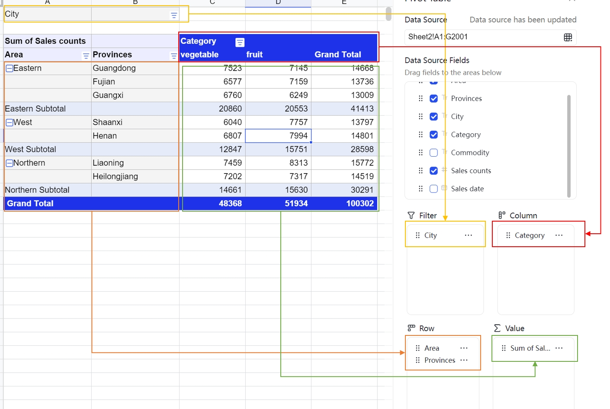

<MetaData
  lang="en-US"
  meta={{
    mobile: true,
    preset: [{
      client: '@univerjs/preset-sheets-advanced',
      locale: '@univerjs/preset-sheets-advanced/locales/en-US',
      style: '@univerjs/preset-sheets-advanced/lib/index.css',
    }],
    plugins: [{
      client: '@univerjs-pro/sheets-pivot',
      facade: '@univerjs-pro/sheets-pivot/facade',
      locale: '@univerjs-pro/sheets-pivot/locale/en-US',
    }, {
      client: '@univerjs-pro/sheets-pivot-ui',
      locale: '@univerjs-pro/sheets-pivot-ui/locale/en-US',
      style: '@univerjs-pro/sheets-pivot-ui/lib/index.css',
    }],
    server: false,
  }}
/>

Pivot tables are a powerful data analysis tool that allows users to quickly summarize, analyze, and visualize large amounts of data. It supports various data operations and formatting options to help users better understand their data.

## Introduction

Data pivot tables are typically used in the following scenarios:

- Summarizing data: Pivot tables can help you quickly summarize data to better understand the overall situation.
- Analyzing data: Pivot tables can help you analyze data to identify patterns and relationships.
- Exploring data: Pivot tables can help you explore data to discover rules and trends.
- Visualizing data: Pivot tables can help you visualize data for better understanding.

A pivot table typically includes the following elements:

- Row labels: Row labels in a pivot table are used to group data.
- Column labels: Column labels in a pivot table are used to group data.
- Values: Values in a pivot table are used to summarize data.

In a pivot table, you can adjust row labels, column labels, and values as needed to better analyze data.



### Data Source

In Univer Sheets, the data source for a pivot table can be either a worksheet or a data range. You can choose different data sources as needed to better analyze your data.
We take the first row of the data source as the default column labels, and the rest as the data source. Therefore, we require the data source to be as organized as possible, avoiding empty rows and columns as much as possible.
For data in the same column, we will automatically recognize the data type to better support the functionality of the pivot table. If the data type is inconsistent in a column, we will default the data type of that column to string.

In Univer Sheets, pivot tables will automatically respond to changes in the data. When the data source changes, the pivot table will automatically update to better analyze the data.

### Filtering

Data pivot tables support filtering on row labels and column labels, and also provide a filter field that does not participate in the main data classification and summary layout of the pivot table but can be used to filter data.

Data pivot tables support two filtering methods:
- Label filtering: Label filtering directly applies to the items of the current label dimension. For example, in the province dimension, we can filter out certain provinces.
- Value filtering: Value filtering requires specifying a value dimension, and then filters the summary results of the value field. For example, we can filter out data with sales less than 1000.

### Sorting

Data pivot table sorting only takes effect on row/column fields, and supports ascending and descending order. The sorting method uses the `localCompare` method. In the future, we will support more sorting methods, such as pinyin sorting.

Data pivot tables support two sorting methods:
- Label sorting: Label sorting directly applies to the items of the current label dimension. For example, in the province dimension, we can sort by province name.
- Value sorting: Value sorting requires specifying a value dimension, and then sorts the summary results of the value field. For example, we can sort by sales amount.

### Aggregation

Data pivot tables support 11 aggregation methods supported by Excel, including: sum, count, data count, average, maximum, minimum, factorial, standard deviation, variance, population standard deviation, and population variance.

Data pivot tables support multiple value dimensions and allow customization of the value dimension area (value position) and position (value index).

This is a complex layout logic, so we only support table view for now. In the future, we will support more views based on demand.

### Drill Down

Drill down refers to the ability for users to double-click on a cell in the value area of a pivot table to view detailed data corresponding to that cell. For example, users can click on a cell in the pivot table to see the detailed data behind it, allowing for better tracing of the original data.

### Grouping

Univer Sheets supports date, numeric, and manual grouping.

- Date grouping: use [`setDateGroupType`](/reference/facade/pivot-table#setdategrouptype) for derived date fields. For calendar-unit grouping of an original date label field, set [`setDateGroupingMode`](/reference/facade/pivot-table#setdategroupingmode) to `univerAPI.Enum.PivotDateGroupingMode.ExcelLike`, then call [`setExcelDateGroup`](/reference/facade/pivot-table#setexceldategroup).
- Numeric grouping: pass a label field ID and interval settings to [`setNumberGroup`](/reference/facade/pivot-table#setnumbergroup).
- Manual grouping: pass the original source field ID and groups of typed members to [`setManualGroups`](/reference/facade/pivot-table#setmanualgroups). Each group needs at least two members; an empty array removes all manual groups for that field.

Use [slicers and timelines](/guides/sheets/features/slicer) to filter tables and pivot reports interactively.

## Plugin Mode

### Installation

```package-install
npm install @univerjs-pro/sheets-pivot @univerjs-pro/sheets-pivot-ui
```

### Usage

```typescript
import { UniverSheetsPivotTablePlugin } from '@univerjs-pro/sheets-pivot' // [!code ++]
import { UniverSheetsPivotTableUIPlugin } from '@univerjs-pro/sheets-pivot-ui' // [!code ++]
import SheetsPivotTableUIEnUS from '@univerjs-pro/sheets-pivot-ui/locale/en-US' // [!code ++]
import SheetsPivotTableEnUS from '@univerjs-pro/sheets-pivot/locale/en-US' // [!code ++]
import { LocaleType, mergeLocales, Univer } from '@univerjs/core'
import '@univerjs-pro/sheets-pivot-ui/lib/index.css' // [!code ++]
import '@univerjs-pro/sheets-pivot/facade' // [!code ++]

const univer = new Univer({
  locale: LocaleType.EN_US,
  locales: {
    [LocaleType.EN_US]: mergeLocales(
      SheetsPivotTableEnUS, // [!code ++]
      SheetsPivotTableUIEnUS, // [!code ++]
    ),
  },
})
```

### Registering Plugins

The pivot table plugin supports flexible registration for different usage scenarios, providing two modes to adapt to various computational needs.

**Registering in the Main Process Only**

The pivot table plugin can be registered in the main process only. This mode is suitable for lightweight tasks, simple operations, and does not require additional configuration of the plugin config. Developers only need to import `UniverSheetsPivotTablePlugin`.

```typescript
univer.registerPlugin(UniverSheetsPivotTablePlugin)
univer.registerPlugin(UniverSheetsPivotTableUIPlugin)
```

**Registering in Both Main and Worker Processes**

For scenarios requiring high performance, the pivot table plugin supports registration in both the main and worker processes. This mode allows the plugin to leverage a multi-threaded architecture for efficient data distribution and computation processing, significantly reducing the computational burden on the main process and enhancing overall performance.

In this mode, the main process is primarily responsible for data distribution, synchronization, and rendering, while the worker process focuses on complex computational tasks. To implement this mode, fine-tuning configuration is required during registration through the config.

```typescript
// main process file
// Setting notExecuteFormula to true indicates that the main process does not perform calculations. It is only responsible for data distribution, synchronization, and rendering.
univer.registerPlugin(UniverSheetsPivotTablePlugin, { notExecuteFormula: true })
univer.registerPlugin(UniverSheetsPivotTableUIPlugin)

// web worker process file
// Setting notExecuteFormula to false indicates that the worker process performs the calculations.
univer.registerPlugin(UniverSheetsPivotTablePlugin, { notExecuteFormula: false })
```

If you have a commercial license for Univer, please refer to [Using License in Client](/server/license#in-plugin-mode) for configuration.

### Plugin configuration [#plugin-configuration]

`UniverSheetsPivotTablePlugin`

| <span data-config-options="">Option</span> | Type | Default | What it does |
| --- | --- | --- | --- |
| `maxLimitItemCount` | `number` | `1000` | Maximum number of items displayed in a pivot field. |
| `autoDateGroup` | `boolean` | `true` | Group date fields added to rows or columns automatically. |
| `dateSystem` | `DateSystem` | `DateSystem.Date1900` | Date system used to group dates. |
| `notExecuteFormula` | `boolean` |  | Selects roles for pivot calculation. Use `true` on the main thread and `false` in the Worker. Omit it for single-threaded use. |

## Mobile support [#mobile-support]

First configure the [mobile editor](/guides/sheets/getting-started/installation#mobile-support). In this page’s plugin-mode setup, replace the desktop registrations below with their mobile exports from the same packages, **before opening a document**. Keep the model plugins, styles, locales and Facade imports; do not register both variants.

| Package | Desktop registration | Mobile registration |
| --- | --- | --- |
| `@univerjs-pro/sheets-pivot-ui` | `UniverSheetsPivotTableUIPlugin` | `UniverSheetsPivotTableMobileUIPlugin` |

## Preset Mode

The pivot table feature is included in the `@univerjs/preset-sheets-advanced` preset, which also includes other advanced features such as drawing and watermark.

### Installation

<Callout>
  The `UniverSheetsAdvancedPreset` preset from `@univerjs/preset-sheets-advanced` depends on the `UniverSheetsDrawingPreset` preset at runtime. Please install `@univerjs/preset-sheets-drawing` first.
</Callout>

```package-install
npm install @univerjs/preset-sheets-drawing @univerjs/preset-sheets-advanced
```

### Usage

```typescript
import { UniverSheetsAdvancedPreset } from '@univerjs/preset-sheets-advanced' // [!code ++]
import UniverPresetSheetsAdvancedEnUS from '@univerjs/preset-sheets-advanced/locales/en-US' // [!code ++]
import { UniverSheetsCorePreset } from '@univerjs/preset-sheets-core'
import UniverPresetSheetsCoreEnUS from '@univerjs/preset-sheets-core/locales/en-US'
import { UniverSheetsDrawingPreset } from '@univerjs/preset-sheets-drawing' // [!code ++]
import UniverPresetSheetsDrawingEnUS from '@univerjs/preset-sheets-drawing/locales/en-US' // [!code ++]
import { createUniver, LocaleType, mergeLocales } from '@univerjs/presets'
import '@univerjs/preset-sheets-core/lib/index.css'
import '@univerjs/preset-sheets-drawing/lib/index.css' // [!code ++]
import '@univerjs/preset-sheets-advanced/lib/index.css' // [!code ++]

const { univerAPI } = createUniver({
  locale: LocaleType.EN_US,
  locales: {
    [LocaleType.EN_US]: mergeLocales(
      UniverPresetSheetsCoreEnUS,
      UniverPresetSheetsDrawingEnUS, // [!code ++]
      UniverPresetSheetsAdvancedEnUS, // [!code ++]
    ),
  },
  presets: [
    UniverSheetsCorePreset(),
    UniverSheetsDrawingPreset(), // [!code ++]
    UniverSheetsAdvancedPreset(), // [!code ++]
  ],
})
```

If you have a commercial license for Univer, please refer to [Using License in Client](/server/license#in-preset-mode) for configuration.

### Preset configuration [#preset-configuration]

`UniverSheetsAdvancedPreset`

| <span data-config-options="">Option</span> | Type | Default | What it does |
| --- | --- | --- | --- |
| <ConfigKey depth={0}>pivot</ConfigKey> | `object` |  | Settings for the selected feature. |
| <ConfigKey depth={1}>maxLimitItemCount</ConfigKey> | `number` | `1000` | Maximum number of items displayed in a pivot field. |

## Facade API

Complete Facade API type definitions can be found in the [FacadeAPI](/reference/facade).

### Importing

<Callout type="info" title="Plugin mode note">
  Only plugin mode requires manually importing the Facade package. Preset mode already includes the corresponding Facade package, so no extra import is needed.
</Callout>

```typescript
import '@univerjs-pro/sheets-pivot/facade'
```

### Add a Pivot Table

[`FWorkbook.addPivotTable`](https://docs.univer.ai/reference/facade/workbook#addpivottable) method is used to add a pivot table, and it will return the `FPivotTable` instance if successful.

```typescript
// should ensure the sheet range A1:G9 is not empty
const fWorkbook = univerAPI.getActiveWorkbook()
const unitId = fWorkbook.getId()
const fSheet = fWorkbook.getActiveSheet()
const subUnitId = fSheet.getSheetId()
const sheetName = fSheet.getSheetName()
const sourceInfo = {
  unitId,
  subUnitId,
  sheetName,
  range: {
    startRow: 0,
    startColumn: 0,
    endRow: 8,
    endColumn: 6,
  },
}
const anchorCellInfo = {
  unitId,
  subUnitId,
  row: 20,
  col: 8,
}
const fPivotTable = await fWorkbook.addPivotTable(sourceInfo, univerAPI.Enum.PositionTypeEnum.Existing, anchorCellInfo)
const pivotTableId = fPivotTable.getPivotTableId()
// add flag to avoid add pivot fields multiple times
let hasAdded = false
// the addPivotTable is async, you can add pivot fields after the pivot table is added
univerAPI.addEvent(univerAPI.Event.PivotTableRendered, async (params) => {
  if (!hasAdded && params.pivotTableId === pivotTableId) {
    hasAdded = true
    await fPivotTable.addField(1, univerAPI.Enum.PivotTableFiledAreaEnum.Row, 0)
    await fPivotTable.addField(1, univerAPI.Enum.PivotTableFiledAreaEnum.Value, 0)
  }
})
```

### Get a Pivot Table

[`FWorkbook.getPivotTableByCell`](https://docs.univer.ai/reference/facade/workbook#getpivottablebycell) method is used to get a pivot table instance by the anchor cell, and it will return the `FPivotTable` instance if the target cell is in a pivot table.

```typescript
const fWorkbook = univerAPI.getActiveWorkbook()
const unitId = fWorkbook.getId()
const fSheet = fWorkbook.getActiveSheet()
const subUnitId = fSheet.getSheetId()

// get pivot table by the cell in FWorkbook.
const fPivotTable = fWorkbook.getPivotTableByCell(unitId, subUnitId, 0, 8)

// get pivot table by the cell in FWorksheet.
const pivotTable2 = fSheet.getPivotTableByCell(0, 8)
```

There are some methods in the [`FPivotTable`](https://docs.univer.ai/reference/facade/pivot-table) instance, which can be used to operate the pivot table.

| Method                                                                                                                         | Description                                                                       |
| ------------------------------------------------------------------------------------------------------------------------------ | --------------------------------------------------------------------------------- |
| [remove](/reference/facade/generic-pivot-table#remove)                             | remove the pivot table from instance                                              |
| [getConfig](https://docs.univer.ai/reference/facade/pivot-table#getconfig)                       | return the pivot table config, the source range info, anchor cell info and config |
| [addField](https://docs.univer.ai/reference/facade/pivot-table#addfield)                         | add a field to pivot table                                                        |
| [removeField](https://docs.univer.ai/reference/facade/pivot-table#removefield)                   | remove a field from pivot table                                                   |
| [updateFieldPosition](https://docs.univer.ai/reference/facade/pivot-table#updatefieldposition)   | update the field position in pivot table                                          |
| [updateValuePosition](https://docs.univer.ai/reference/facade/pivot-table#updatevalueposition)   | control the ∑Value position                                                       |
| [setSubtotalType](https://docs.univer.ai/reference/facade/pivot-table#setsubtotaltype)           | set the subtotal type of the field                                                |
| [setLabelSort](https://docs.univer.ai/reference/facade/pivot-table#setlabelsort)                 | set the label sort of the field                                                   |
| [setLabelManualFilter](https://docs.univer.ai/reference/facade/pivot-table#setlabelmanualfilter) | set the label filter of the field                                                 |
| [renameField](https://docs.univer.ai/reference/facade/pivot-table#renamefield)                   | rename the field                                                                  |
| [setValueFilter](/reference/facade/pivot-table#setvaluefilter)             | set value filter                                                                  |
| [reset](/reference/facade/generic-pivot-table#reset)                               | reset the pivot table fields                                                      |
| [setFieldsConfig](https://docs.univer.ai/reference/facade/pivot-table#setfieldsconfig)           | set the pivot table fields config                                                 |
| [getValueFilters](https://docs.univer.ai/reference/facade/pivot-table#getvaluefilters)           | get all value filters of the pivot table                                          |

### Event Listeners

Complete event type definitions can be found in the [Events](https://docs.univer.ai/reference/facade/events).

`univerAPI.Event.BeforePivotTableAdd` event is triggered before adding a pivot table.

```typescript
const disposable = univerAPI.addEvent(univerAPI.Event.BeforePivotTableAdd, (params) => {
  const { positionType, targetCellInfo } = params
  if (positionType === univerAPI.Enum.PositionTypeEnum.Existing && targetCellInfo.sheetName === 'Sheet 1') {
    // Cancel the pivot table adding operation
    params.cancel = true
    console.log(`The pivot table can't be added to the sheet ${targetCellInfo.sheetName}`)
  }
})

// Remove the event listener, use `disposable.dispose()`
```

`univerAPI.Event.PivotTableAdded` event is triggered after adding a pivot table.

```typescript
const disposable = univerAPI.addEvent(univerAPI.Event.PivotTableAdded, (params) => {
  const { positionType, targetCellInfo } = params
  if (positionType === univerAPI.Enum.PositionTypeEnum.Existing) {
    console.log('A pivot table created in an existing sheet')
    console.log(`
      The target sheet name is ${targetCellInfo.sheetName},
      the target row is ${targetCellInfo.row}, the target column is ${targetCellInfo.column}
    `)
  } else {
    console.log('A pivot table created in a new sheet')
  }
})

// Remove the event listener, use `disposable.dispose()`
```

`univerAPI.Event.BeforePivotTableMove` event is triggered before moving a pivot table.

```typescript
const disposable = univerAPI.addEvent(univerAPI.Event.BeforePivotTableMove, (params) => {
  const { pivotTableId, targetCellInfo } = params
  if (pivotTableId === 'pivotTable1' && targetCellInfo.sheetName === 'Sheet 1') {
    // Cancel the move pivot table operation
    params.cancel = true
    console.log(`The pivot table can't be moved to the sheet ${targetCellInfo.sheetName}`)
  }
})

// Remove the event listener, use `disposable.dispose()`
```

`univerAPI.Event.PivotTableMoved` event is triggered after moving a pivot table.

```typescript
const disposable = univerAPI.addEvent(univerAPI.Event.PivotTableMoved, (params) => {
  const { pivotTableId, targetCellInfo, originTargetInfo } = params
  if (pivotTableId === 'pivotTable1') {
    console.log(`
      The pivot table moved from row: ${originTargetInfo.row} & column: ${originTargetInfo.column}
      to the sheet ${targetCellInfo.sheetName} row: ${targetCellInfo.row} & column: ${targetCellInfo.column}
    `)
  }
})

// Remove the event listener, use `disposable.dispose()`
```

`univerAPI.Event.PivotTableRendered` event is triggered after rendering a pivot table.

```typescript
// import { unionPivotViewRange } from '@univerjs-pro/sheets-pivot';
const disposable = univerAPI.addEvent(univerAPI.Event.PivotTableRendered, (params) => {
  const { pivotTableId, rangeInfo } = params
  console.log(`The pivot table ${pivotTableId} has been rendered`)
  if (rangeInfo) {
    console.log(unionPivotViewRange(rangeInfo))
  }
})

// Remove the event listener, use `disposable.dispose()`
```

`univerAPI.Event.PivotTableRemoved` event is triggered after removing a pivot table.

```typescript
const disposable = univerAPI.addEvent(univerAPI.Event.PivotTableRemoved, (params) => {
  const { pivotTableId } = params
  console.log(`The pivot table ${pivotTableId} has been removed`)
})

// Remove the event listener, use `disposable.dispose()`
```

`univerAPI.Event.PivotTableFieldAdded` event is triggered after adding a field to a pivot table.

```typescript
const fWorkbook = univerAPI.getActiveWorkbook()
const disposable = univerAPI.addEvent(univerAPI.Event.PivotTableFieldAdded, (params) => {
  const { pivotTableId, fieldId, fieldArea, fieldIndex } = params
  const pivotTable = fWorkbook.getPivotTableById(pivotTableId)
  const fieldSetting = pivotTable.getFieldSetting(fieldId)
  console.log(fieldSetting)
})

// Remove the event listener, use `disposable.dispose()`
```

`univerAPI.Event.PivotTableFieldRemoved` event is triggered after removing a field from a pivot table.

```typescript
const fWorkbook = univerAPI.getActiveWorkbook()
const disposable = univerAPI.addEvent(univerAPI.Event.PivotTableFieldRemoved, (params) => {
  const { pivotTableId, fieldId } = params
  const pivotTable = fWorkbook.getPivotTableById(pivotTableId)
  const fieldSetting = pivotTable.getFieldSetting(fieldId)
  console.log(fieldSetting)
})

// Remove the event listener, use `disposable.dispose()`
```

`univerAPI.Event.PivotTableFieldMoved` event is triggered after moving a field in a pivot table.

```typescript
const fWorkbook = univerAPI.getActiveWorkbook()
const disposable = univerAPI.addEvent(univerAPI.Event.PivotTableFieldMoved, (params) => {
  const { pivotTableId, fieldId, fieldArea, fieldIndex } = params
  const pivotTable = fWorkbook.getPivotTableById(pivotTableId)
  const fieldSetting = pivotTable.getFieldSetting(fieldId)
  console.log(`The source name ${fieldSetting.sourceName} the display name ${fieldSetting.displayName}`)
})

// Remove the event listener, use `disposable.dispose()`
```

`univerAPI.Event.PivotTableFieldCollapseChanged` event is triggered after expanding/collapsing a dimension in a pivot table.

```typescript
const fWorkbook = univerAPI.getActiveWorkbook()
const disposable = univerAPI.addEvent(univerAPI.Event.PivotTableFieldCollapseChanged, (params) => {
  const { pivotTableId, fieldId, isCollapsed } = params
  const pivotTable = fWorkbook.getPivotTableById(pivotTableId)
  const fieldSetting = pivotTable.getFieldSetting(fieldId)
  console.log(`The source name ${fieldSetting.sourceName} the display name ${fieldSetting.displayName}`)
})

// Remove the event listener, use `disposable.dispose()`
```

`univerAPI.Event.PivotTableFieldFilterChanged` event is triggered after filtering a dimension in a pivot table.

```typescript
const fWorkbook = univerAPI.getActiveWorkbook()
const disposable = univerAPI.addEvent(univerAPI.Event.PivotTableFieldFilterChanged, (params) => {
  const { pivotTableId, fieldId, filter } = params
  const pivotTable = fWorkbook.getPivotTableById(pivotTableId)
  const fieldSetting = pivotTable.getFieldSetting(fieldId)
  console.log(`The Checklist filter value is ${fieldSetting.filterInfo.checklist}`)
})

// Remove the event listener, use `disposable.dispose()`
```

`univerAPI.Event.PivotTableFieldSortChanged` event is triggered after sorting a dimension in a pivot table.

```typescript
const fWorkbook = univerAPI.getActiveWorkbook()
const disposable = univerAPI.addEvent(univerAPI.Event.PivotTableFieldSortChanged, (params) => {
  const { pivotTableId, fieldId, sort } = params
  const pivotTable = fWorkbook.getPivotTableById(pivotTableId)
  const fieldSetting = pivotTable.getFieldSetting(fieldId)
  console.log(`The sort info is ${fieldSetting.sortInfo}`)
})

// Remove the event listener, use `disposable.dispose()`
```

`univerAPI.Event.PivotTableFieldSettingChanged` event is triggered after changing the setting of a dimension in a pivot table.

```typescript
const fWorkbook = univerAPI.getActiveWorkbook()
const disposable = univerAPI.addEvent(univerAPI.Event.PivotTableFieldSettingChanged, (params) => {
  const { pivotTableId, fieldId, setting } = params
  const pivotTable = fWorkbook.getPivotTableById(pivotTableId)
  const fieldSetting = pivotTable.getFieldSetting(fieldId)
  console.log(`The source name ${fieldSetting.sourceName} the display name ${fieldSetting.displayName}`)
})

// Remove the event listener, use `disposable.dispose()`
```

`univerAPI.Event.PivotTableValuePositionChanged` event is triggered after changing the position of a value in a pivot table.

```typescript
const fWorkbook = univerAPI.getActiveWorkbook()
const disposable = univerAPI.addEvent(univerAPI.Event.PivotTableValuePositionChanged, (params) => {
  const { pivotTableId, valueId, position } = params
  const pivotTable = fWorkbook.getPivotTableById(pivotTableId)
  const valueSetting = pivotTable.getValueSetting(valueId)
  console.log(`The source name ${valueSetting.sourceName} the display name ${valueSetting.displayName}`)
})

// Remove the event listener, use `disposable.dispose()`
```

## Blocked output [#blocked-output]

Leave room for the report to expand. Existing cell content, merged cells and other pivot tables can block the output. Clear the obstruction or move the report to an empty range.

## Show values as [#show-values-as]

Use `setShowDataAs()` on a value field to display its share of a row, column, or grand total, or a difference from a base item. This changes the displayed calculation without replacing the source data. `getShowDataAs()` reads the setting and `resetShowDataAs()` restores normal calculation.

```ts
const valueId = fPivotTable.getFieldIdsByArea(
  univerAPI.Enum.PivotTableFiledAreaEnum.Value,
)[0]
if (valueId) {
  await fPivotTable.setShowDataAs(valueId, {
    type: univerAPI.Enum.PivotShowAsTypeEnum.percentOfGrandTotal,
  })
  console.log(fPivotTable.getShowDataAs(valueId))
}
```

The example uses an existing pivot table `fPivotTable`. Select a value field ID, not a source column or row field ID. Difference and running-total modes also require the appropriate base field and base item settings.

## Copy pivot tables with a worksheet [#copy-with-worksheet]

With the pivot plugin registered, duplicating a worksheet also copies the pivot tables on it and preserves their field configuration. Each copy receives a new pivot-table ID. A source range on the copied worksheet is redirected to the new worksheet; a source on another worksheet or workbook keeps its original reference. The copied tables participate in the worksheet copy's undo and redo.

```ts
const workbook = univerAPI.getActiveWorkbook()
if (!workbook) throw new Error('No active workbook')

const copiedSheet = workbook.duplicateActiveSheet()
console.log(copiedSheet.getSheetName())
```

## Multiple filters and date conditions [#multiple-filters]

`setOptions({ allowMultipleFilters: true })` lets member selection, a label/date condition, and a value filter coexist on one field. Omitted or `false` uses replacement semantics; turning it off when categories conflict clears report filters. A field still accepts at most one value filter.

`setDateFilter()` accepts fixed date operators such as `dateEqual`, `dateOlderThan`, and `dateBetween`. `expected` uses Excel serial values in the workbook's date system, with two values for a between condition. `useWholeDay: true` ignores the time within each day; omitted or `false` compares exact serials. Use the report field ID, not a source column index. The following continues with `fPivotTable` above and a source column named `Date`.

`getDateFilter()` returns a detached condition; `clearDateFilter()` clears only the date condition. These commands participate in undo and collaboration. Check their boolean result: an active slicer can prevent an incompatible filter from being applied.

```ts
if (!fPivotTable) throw new Error('PivotTable not found')
await fPivotTable.setOptions({ allowMultipleFilters: true })

const dateField = Object.values(fPivotTable.getConfig()?.fieldsConfig.dimension ?? {})
  .find((field) => field.sourceName === 'Date')
if (!dateField) throw new Error('Add the Date field to the report first')

await fPivotTable.setDateFilter(dateField.id, {
  operator: univerAPI.Enum.ST_PivotFilterOperatorEnum.dateEqual,
  expected: 45293,
  useWholeDay: true,
})
console.log(fPivotTable.getDateFilter(dateField.id))
await fPivotTable.clearDateFilter(dateField.id)
```

## GETPIVOTDATA [#getpivotdata]

Use `=GETPIVOTDATA("Sales",$I$1,"Region","East")` to read an aggregate from a visible PivotTable report whose upper-left cell is I1. The value field can be its displayed caption or source name. Use a single-cell reference for the anchor and provide complete field/item pairs.

The current implementation scans the visible report up to 200 rows down and 50 columns right from the anchor; it does not query hidden source records. An unmatched field/item or unavailable result returns `#REF!`; an invalid argument count or a non-single-cell anchor returns `#VALUE!`.
