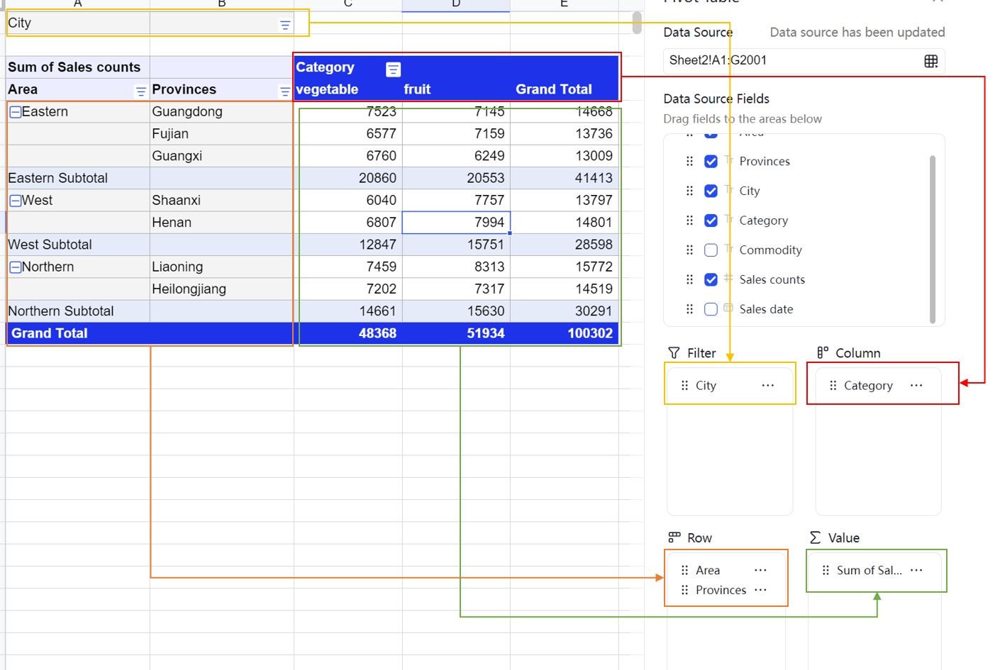

<MetaData
  lang="ru-RU"
  meta={{
    mobile: true,
    preset: [{
      client: '@univerjs/preset-sheets-advanced',
      locale: '@univerjs/preset-sheets-advanced/locales/ru-RU',
      style: '@univerjs/preset-sheets-advanced/lib/index.css',
    }],
    plugins: [{
      client: '@univerjs-pro/sheets-pivot',
      facade: '@univerjs-pro/sheets-pivot/facade',
      locale: '@univerjs-pro/sheets-pivot/locale/ru-RU',
    }, {
      client: '@univerjs-pro/sheets-pivot-ui',
      locale: '@univerjs-pro/sheets-pivot-ui/locale/ru-RU',
      style: '@univerjs-pro/sheets-pivot-ui/lib/index.css',
    }],
    server: false,
  }}
/>

Сводные таблицы — мощный инструмент анализа данных, который позволяет быстро обобщать, анализировать и визуализировать большие объёмы информации. Они поддерживают различные операции с данными и параметры форматирования, помогая пользователям лучше понимать свои данные.

## Введение

Сводные таблицы обычно используют в следующих случаях:

- Обобщение данных: сводные таблицы позволяют быстро подвести итоги и получить общее представление о данных.
- Анализ данных: сводные таблицы помогают выявлять закономерности и взаимосвязи.
- Исследование данных: сводные таблицы помогают находить правила и тенденции.
- Визуализация данных: сводные таблицы позволяют представить данные наглядно и упростить их восприятие.

Сводная таблица обычно включает следующие элементы:

- Метки строк: используются для группировки данных по строкам.
- Метки столбцов: используются для группировки данных по столбцам.
- Значения: используются для обобщения данных.

Чтобы точнее анализировать данные, можно по необходимости настраивать метки строк, метки столбцов и значения.



### Источник данных

В Univer Sheets источником данных для сводной таблицы может быть лист или диапазон данных. Выберите подходящий источник в зависимости от задач анализа.
По умолчанию первая строка источника используется как метки столбцов, а остальные строки — как данные. Поэтому источник следует организовать как можно аккуратнее, по возможности избегая пустых строк и столбцов.
Для данных в одном столбце тип определяется автоматически, чтобы обеспечить корректную работу сводной таблицы. Если в столбце встречаются данные разных типов, тип этого столбца по умолчанию считается строковым.

Сводные таблицы в Univer Sheets автоматически реагируют на изменения данных. При изменении источника сводная таблица обновляется автоматически.

### Фильтрация

Сводные таблицы поддерживают фильтрацию по меткам строк и столбцов. Также доступно поле фильтра: оно не участвует в основной классификации и итоговой компоновке сводной таблицы, но позволяет отбирать данные.

Сводные таблицы поддерживают два способа фильтрации:
- Фильтрация по меткам: применяется непосредственно к элементам текущего измерения меток. Например, в измерении по регионам можно исключить отдельные регионы.
- Фильтрация по значениям: сначала указывается измерение значений, после чего фильтруются итоговые результаты поля значений. Например, можно исключить данные, где объём продаж меньше 1000.

### Сортировка

Сортировка в сводной таблице действует только для полей строк и столбцов и поддерживает порядок по возрастанию и убыванию. Для сортировки используется метод `localCompare`. В будущем появятся дополнительные способы сортировки, например по пиньиню.

Сводные таблицы поддерживают два способа сортировки:
- Сортировка по меткам: применяется непосредственно к элементам текущего измерения меток. Например, в измерении по регионам можно сортировать по названию региона.
- Сортировка по значениям: сначала указывается измерение значений, после чего сортируются итоговые результаты поля значений. Например, данные можно упорядочить по объёму продаж.

### Агрегирование

Сводные таблицы поддерживают 11 методов агрегирования, совместимых с Excel: сумму, количество, количество данных, среднее, максимум, минимум, произведение, стандартное отклонение, дисперсию, стандартное отклонение генеральной совокупности и дисперсию генеральной совокупности.

Сводные таблицы поддерживают несколько измерений значений и позволяют настраивать область измерений значений (расположение значений) и их позицию (индекс значения).

Поскольку эта логика компоновки достаточно сложна, пока поддерживается только табличное представление. Другие представления будут добавляться по мере необходимости.

### Детализация

Детализация позволяет дважды щёлкнуть ячейку в области значений сводной таблицы и просмотреть соответствующие ей исходные данные. Это упрощает переход от итогового значения к данным, на основе которых оно рассчитано.

### Группировка

Univer Sheets поддерживает группировку по датам, по числовым интервалам и вручную.

- Группировка по датам: для производных полей дат используйте [`setDateGroupType`](/reference/facade/pivot-table#setdategrouptype). Чтобы сгруппировать исходное поле меток дат по календарным единицам, задайте `univerAPI.Enum.PivotDateGroupingMode.ExcelLike` через [`setDateGroupingMode`](/reference/facade/pivot-table#setdategroupingmode), затем вызовите [`setExcelDateGroup`](/reference/facade/pivot-table#setexceldategroup).
- Числовая группировка: передайте ID поля меток и параметры интервалов в [`setNumberGroup`](/reference/facade/pivot-table#setnumbergroup).
- Ручная группировка: передайте ID исходного поля и группы элементов с сохранением типов значений в [`setManualGroups`](/reference/facade/pivot-table#setmanualgroups). В каждой группе должно быть не менее двух элементов; пустой массив удаляет все ручные группы этого поля.

Используйте [срезы и временные шкалы](/guides/sheets/features/slicer) для интерактивной фильтрации таблиц и сводных отчётов.

## Режим плагинов

### Установка

```package-install
npm install @univerjs-pro/sheets-pivot @univerjs-pro/sheets-pivot-ui
```

### Использование

```typescript
import { UniverSheetsPivotTablePlugin } from '@univerjs-pro/sheets-pivot' // [!code ++]
import { UniverSheetsPivotTableUIPlugin } from '@univerjs-pro/sheets-pivot-ui' // [!code ++]
import SheetsPivotTableUIEnUS from '@univerjs-pro/sheets-pivot-ui/locale/en-US' // [!code ++]
import SheetsPivotTableEnUS from '@univerjs-pro/sheets-pivot/locale/en-US' // [!code ++]
import { LocaleType, mergeLocales, Univer } from '@univerjs/core'
import '@univerjs-pro/sheets-pivot-ui/lib/index.css' // [!code ++]
import '@univerjs-pro/sheets-pivot/facade' // [!code ++]

const univer = new Univer({
  locale: LocaleType.EN_US,
  locales: {
    [LocaleType.EN_US]: mergeLocales(
      SheetsPivotTableEnUS, // [!code ++]
      SheetsPivotTableUIEnUS, // [!code ++]
    ),
  },
})
```

### Регистрация плагинов

Плагин сводных таблиц можно регистрировать по-разному в зависимости от сценария использования. Доступны два режима для различных вычислительных задач.

**Регистрация только в основном процессе**

Плагин сводных таблиц можно зарегистрировать только в основном процессе. Этот режим подходит для небольших задач и простых операций и не требует дополнительной настройки конфигурации плагина. Достаточно импортировать `UniverSheetsPivotTablePlugin`.

```typescript
univer.registerPlugin(UniverSheetsPivotTablePlugin)
univer.registerPlugin(UniverSheetsPivotTableUIPlugin)
```

**Регистрация в основном и рабочем процессах**

Для сценариев с высокими требованиями к производительности плагин сводных таблиц можно зарегистрировать как в основном, так и в рабочем процессе. В этом режиме многопоточная архитектура эффективно распределяет данные и вычисления, заметно снижая нагрузку на основной процесс и повышая общую производительность.

В этом режиме основной процесс отвечает прежде всего за распределение данных, синхронизацию и отрисовку, а рабочий процесс выполняет сложные вычисления. Для использования режима необходимо точно настроить параметры при регистрации.

```typescript
// main process file
// Setting notExecuteFormula to true indicates that the main process does not perform calculations. It is only responsible for data distribution, synchronization, and rendering.
univer.registerPlugin(UniverSheetsPivotTablePlugin, { notExecuteFormula: true })
univer.registerPlugin(UniverSheetsPivotTableUIPlugin)

// web worker process file
// Setting notExecuteFormula to false indicates that the worker process performs the calculations.
univer.registerPlugin(UniverSheetsPivotTablePlugin, { notExecuteFormula: false })
```

Если у вас есть коммерческая лицензия Univer, инструкции по настройке см. в разделе [Использование лицензии в клиенте](/server/license#in-plugin-mode).

### Настройка плагинов [#plugin-configuration]

`UniverSheetsPivotTablePlugin`

| <span data-config-options="">Параметр</span> | Тип | По умолчанию | Действие |
| --- | --- | --- | --- |
| `maxLimitItemCount` | `number` | `1000` | Максимум элементов в одном поле сводной таблицы. |
| `autoDateGroup` | `boolean` | `true` | Автоматически группирует поля дат, добавленные в строки или столбцы. |
| `dateSystem` | `DateSystem` | `DateSystem.Date1900` | Система дат для группировки. |
| `notExecuteFormula` | `boolean` |  | Задаёт роль потока при расчёте сводной таблицы. В основном потоке укажите `true`, а в Worker — `false`. Для одного потока опустите параметр. |

## Поддержка мобильных устройств [#mobile-support]

Сначала настройте [мобильный редактор](/guides/sheets/getting-started/installation#mobile-support). В коде инициализации режима плагинов на этой странице замените указанные настольные регистрации мобильными экспортами тех же пакетов **до открытия документа**. Сохраните модели, стили, локализации и импорты Facade; не регистрируйте оба варианта.

| Пакет | Настольная регистрация | Мобильная регистрация |
| --- | --- | --- |
| `@univerjs-pro/sheets-pivot-ui` | `UniverSheetsPivotTableUIPlugin` | `UniverSheetsPivotTableMobileUIPlugin` |

## Режим предустановки

Функция сводных таблиц входит в предустановку `@univerjs/preset-sheets-advanced`, которая также включает другие расширенные возможности, например рисование и водяные знаки.

### Установка

<Callout>
  Во время выполнения предустановка `UniverSheetsAdvancedPreset` из `@univerjs/preset-sheets-advanced` зависит от `UniverSheetsDrawingPreset`. Сначала установите `@univerjs/preset-sheets-drawing`.
</Callout>

```package-install
npm install @univerjs/preset-sheets-drawing @univerjs/preset-sheets-advanced
```

### Использование

```typescript
import { UniverSheetsAdvancedPreset } from '@univerjs/preset-sheets-advanced' // [!code ++]
import UniverPresetSheetsAdvancedEnUS from '@univerjs/preset-sheets-advanced/locales/en-US' // [!code ++]
import { UniverSheetsCorePreset } from '@univerjs/preset-sheets-core'
import UniverPresetSheetsCoreEnUS from '@univerjs/preset-sheets-core/locales/en-US'
import { UniverSheetsDrawingPreset } from '@univerjs/preset-sheets-drawing' // [!code ++]
import UniverPresetSheetsDrawingEnUS from '@univerjs/preset-sheets-drawing/locales/en-US' // [!code ++]
import { createUniver, LocaleType, mergeLocales } from '@univerjs/presets'
import '@univerjs/preset-sheets-core/lib/index.css'
import '@univerjs/preset-sheets-drawing/lib/index.css' // [!code ++]
import '@univerjs/preset-sheets-advanced/lib/index.css' // [!code ++]

const { univerAPI } = createUniver({
  locale: LocaleType.EN_US,
  locales: {
    [LocaleType.EN_US]: mergeLocales(
      UniverPresetSheetsCoreEnUS,
      UniverPresetSheetsDrawingEnUS, // [!code ++]
      UniverPresetSheetsAdvancedEnUS, // [!code ++]
    ),
  },
  presets: [
    UniverSheetsCorePreset(),
    UniverSheetsDrawingPreset(), // [!code ++]
    UniverSheetsAdvancedPreset(), // [!code ++]
  ],
})
```

Если у вас есть коммерческая лицензия Univer, инструкции по настройке см. в разделе [Использование лицензии в клиенте](/server/license#in-preset-mode).

### Настройка пресетов [#preset-configuration]

`UniverSheetsAdvancedPreset`

| <span data-config-options="">Параметр</span> | Тип | По умолчанию | Действие |
| --- | --- | --- | --- |
| <ConfigKey depth={0}>pivot</ConfigKey> | `object` |  | Параметры этой функции. |
| <ConfigKey depth={1}>maxLimitItemCount</ConfigKey> | `number` | `1000` | Максимум элементов в одном поле сводной таблицы. |

## Facade API

Полные определения типов Facade API доступны в [справочнике Facade API](/reference/facade).

### Импорт

<Callout type="info" title="Примечание о режиме плагинов">
  Вручную импортировать пакет Facade нужно только в режиме плагинов. В режиме предустановки соответствующий пакет Facade уже подключён, поэтому дополнительный импорт не требуется.
</Callout>

```typescript
import '@univerjs-pro/sheets-pivot/facade'
```

### Добавление сводной таблицы

Метод [`FWorkbook.addPivotTable`](https://docs.univer.ai/reference/facade/workbook#addpivottable) добавляет сводную таблицу и при успешном выполнении возвращает экземпляр `FPivotTable`.

```typescript
// should ensure the sheet range A1:G9 is not empty
const fWorkbook = univerAPI.getActiveWorkbook()
const unitId = fWorkbook.getId()
const fSheet = fWorkbook.getActiveSheet()
const subUnitId = fSheet.getSheetId()
const sheetName = fSheet.getSheetName()
const sourceInfo = {
  unitId,
  subUnitId,
  sheetName,
  range: {
    startRow: 0,
    startColumn: 0,
    endRow: 8,
    endColumn: 6,
  },
}
const anchorCellInfo = {
  unitId,
  subUnitId,
  row: 20,
  col: 8,
}
const fPivotTable = await fWorkbook.addPivotTable(sourceInfo, univerAPI.Enum.PositionTypeEnum.Existing, anchorCellInfo)
const pivotTableId = fPivotTable.getPivotTableId()
// add flag to avoid add pivot fields multiple times
let hasAdded = false
// the addPivotTable is async, you can add pivot fields after the pivot table is added
univerAPI.addEvent(univerAPI.Event.PivotTableRendered, async (params) => {
  if (!hasAdded && params.pivotTableId === pivotTableId) {
    hasAdded = true
    await fPivotTable.addField(1, univerAPI.Enum.PivotTableFiledAreaEnum.Row, 0)
    await fPivotTable.addField(1, univerAPI.Enum.PivotTableFiledAreaEnum.Value, 0)
  }
})
```

### Получение сводной таблицы

Метод [`FWorkbook.getPivotTableByCell`](https://docs.univer.ai/reference/facade/workbook#getpivottablebycell) получает экземпляр сводной таблицы по опорной ячейке. Если целевая ячейка находится в сводной таблице, метод возвращает экземпляр `FPivotTable`.

```typescript
const fWorkbook = univerAPI.getActiveWorkbook()
const unitId = fWorkbook.getId()
const fSheet = fWorkbook.getActiveSheet()
const subUnitId = fSheet.getSheetId()

// get pivot table by the cell in FWorkbook.
const fPivotTable = fWorkbook.getPivotTableByCell(unitId, subUnitId, 0, 8)

// get pivot table by the cell in FWorksheet.
const pivotTable2 = fSheet.getPivotTableByCell(0, 8)
```

Экземпляр [`FPivotTable`](https://docs.univer.ai/reference/facade/pivot-table) предоставляет следующие методы для работы со сводной таблицей:

| Метод                                                                                                                          | Описание                                                                           |
| ------------------------------------------------------------------------------------------------------------------------------ | --------------------------------------------------------------------------------- |
| [remove](/reference/facade/generic-pivot-table#remove)                             | удалить сводную таблицу                                                            |
| [getConfig](https://docs.univer.ai/reference/facade/pivot-table#getconfig)                       | вернуть конфигурацию сводной таблицы, сведения об исходном диапазоне и опорной ячейке |
| [addField](https://docs.univer.ai/reference/facade/pivot-table#addfield)                         | добавить поле в сводную таблицу                                                    |
| [removeField](https://docs.univer.ai/reference/facade/pivot-table#removefield)                   | удалить поле из сводной таблицы                                                    |
| [updateFieldPosition](https://docs.univer.ai/reference/facade/pivot-table#updatefieldposition)   | изменить позицию поля в сводной таблице                                            |
| [updateValuePosition](https://docs.univer.ai/reference/facade/pivot-table#updatevalueposition)   | управлять позицией ∑Значения                                                       |
| [setSubtotalType](https://docs.univer.ai/reference/facade/pivot-table#setsubtotaltype)           | задать тип промежуточного итога для поля                                           |
| [setLabelSort](https://docs.univer.ai/reference/facade/pivot-table#setlabelsort)                 | задать сортировку меток поля                                                       |
| [setLabelManualFilter](https://docs.univer.ai/reference/facade/pivot-table#setlabelmanualfilter) | задать фильтр меток поля                                                          |
| [renameField](https://docs.univer.ai/reference/facade/pivot-table#renamefield)                   | переименовать поле                                                                |
| [setValueFilter](/reference/facade/pivot-table#setvaluefilter)             | задать фильтр значений                                                            |
| [reset](/reference/facade/generic-pivot-table#reset)                               | сбросить поля сводной таблицы                                                     |
| [setFieldsConfig](https://docs.univer.ai/reference/facade/pivot-table#setfieldsconfig)           | задать конфигурацию полей сводной таблицы                                         |
| [getValueFilters](https://docs.univer.ai/reference/facade/pivot-table#getvaluefilters)           | получить все фильтры значений сводной таблицы                                     |

### Обработчики событий

Полные определения типов событий доступны в разделе [События](https://docs.univer.ai/reference/facade/events).

Событие `univerAPI.Event.BeforePivotTableAdd` срабатывает перед добавлением сводной таблицы.

```typescript
const disposable = univerAPI.addEvent(univerAPI.Event.BeforePivotTableAdd, (params) => {
  const { positionType, targetCellInfo } = params
  if (positionType === univerAPI.Enum.PositionTypeEnum.Existing && targetCellInfo.sheetName === 'Sheet 1') {
    // Cancel the pivot table adding operation
    params.cancel = true
    console.log(`The pivot table can't be added to the sheet ${targetCellInfo.sheetName}`)
  }
})

// Remove the event listener, use `disposable.dispose()`
```

Событие `univerAPI.Event.PivotTableAdded` срабатывает после добавления сводной таблицы.

```typescript
const disposable = univerAPI.addEvent(univerAPI.Event.PivotTableAdded, (params) => {
  const { positionType, targetCellInfo } = params
  if (positionType === univerAPI.Enum.PositionTypeEnum.Existing) {
    console.log('A pivot table created in an existing sheet')
    console.log(`
      The target sheet name is ${targetCellInfo.sheetName},
      the target row is ${targetCellInfo.row}, the target column is ${targetCellInfo.column}
    `)
  } else {
    console.log('A pivot table created in a new sheet')
  }
})

// Remove the event listener, use `disposable.dispose()`
```

Событие `univerAPI.Event.BeforePivotTableMove` срабатывает перед перемещением сводной таблицы.

```typescript
const disposable = univerAPI.addEvent(univerAPI.Event.BeforePivotTableMove, (params) => {
  const { pivotTableId, targetCellInfo } = params
  if (pivotTableId === 'pivotTable1' && targetCellInfo.sheetName === 'Sheet 1') {
    // Cancel the move pivot table operation
    params.cancel = true
    console.log(`The pivot table can't be moved to the sheet ${targetCellInfo.sheetName}`)
  }
})

// Remove the event listener, use `disposable.dispose()`
```

Событие `univerAPI.Event.PivotTableMoved` срабатывает после перемещения сводной таблицы.

```typescript
const disposable = univerAPI.addEvent(univerAPI.Event.PivotTableMoved, (params) => {
  const { pivotTableId, targetCellInfo, originTargetInfo } = params
  if (pivotTableId === 'pivotTable1') {
    console.log(`
      The pivot table moved from row: ${originTargetInfo.row} & column: ${originTargetInfo.column}
      to the sheet ${targetCellInfo.sheetName} row: ${targetCellInfo.row} & column: ${targetCellInfo.column}
    `)
  }
})

// Remove the event listener, use `disposable.dispose()`
```

Событие `univerAPI.Event.PivotTableRendered` срабатывает после отрисовки сводной таблицы.

```typescript
// import { unionPivotViewRange } from '@univerjs-pro/sheets-pivot';
const disposable = univerAPI.addEvent(univerAPI.Event.PivotTableRendered, (params) => {
  const { pivotTableId, rangeInfo } = params
  console.log(`The pivot table ${pivotTableId} has been rendered`)
  if (rangeInfo) {
    console.log(unionPivotViewRange(rangeInfo))
  }
})

// Remove the event listener, use `disposable.dispose()`
```

Событие `univerAPI.Event.PivotTableRemoved` срабатывает после удаления сводной таблицы.

```typescript
const disposable = univerAPI.addEvent(univerAPI.Event.PivotTableRemoved, (params) => {
  const { pivotTableId } = params
  console.log(`The pivot table ${pivotTableId} has been removed`)
})

// Remove the event listener, use `disposable.dispose()`
```

Событие `univerAPI.Event.PivotTableFieldAdded` срабатывает после добавления поля в сводную таблицу.

```typescript
const fWorkbook = univerAPI.getActiveWorkbook()
const disposable = univerAPI.addEvent(univerAPI.Event.PivotTableFieldAdded, (params) => {
  const { pivotTableId, fieldId, fieldArea, fieldIndex } = params
  const pivotTable = fWorkbook.getPivotTableById(pivotTableId)
  const fieldSetting = pivotTable.getFieldSetting(fieldId)
  console.log(fieldSetting)
})

// Remove the event listener, use `disposable.dispose()`
```

Событие `univerAPI.Event.PivotTableFieldRemoved` срабатывает после удаления поля из сводной таблицы.

```typescript
const fWorkbook = univerAPI.getActiveWorkbook()
const disposable = univerAPI.addEvent(univerAPI.Event.PivotTableFieldRemoved, (params) => {
  const { pivotTableId, fieldId } = params
  const pivotTable = fWorkbook.getPivotTableById(pivotTableId)
  const fieldSetting = pivotTable.getFieldSetting(fieldId)
  console.log(fieldSetting)
})

// Remove the event listener, use `disposable.dispose()`
```

Событие `univerAPI.Event.PivotTableFieldMoved` срабатывает после перемещения поля в сводной таблице.

```typescript
const fWorkbook = univerAPI.getActiveWorkbook()
const disposable = univerAPI.addEvent(univerAPI.Event.PivotTableFieldMoved, (params) => {
  const { pivotTableId, fieldId, fieldArea, fieldIndex } = params
  const pivotTable = fWorkbook.getPivotTableById(pivotTableId)
  const fieldSetting = pivotTable.getFieldSetting(fieldId)
  console.log(`The source name ${fieldSetting.sourceName} the display name ${fieldSetting.displayName}`)
})

// Remove the event listener, use `disposable.dispose()`
```

Событие `univerAPI.Event.PivotTableFieldCollapseChanged` срабатывает после разворачивания или сворачивания измерения в сводной таблице.

```typescript
const fWorkbook = univerAPI.getActiveWorkbook()
const disposable = univerAPI.addEvent(univerAPI.Event.PivotTableFieldCollapseChanged, (params) => {
  const { pivotTableId, fieldId, isCollapsed } = params
  const pivotTable = fWorkbook.getPivotTableById(pivotTableId)
  const fieldSetting = pivotTable.getFieldSetting(fieldId)
  console.log(`The source name ${fieldSetting.sourceName} the display name ${fieldSetting.displayName}`)
})

// Remove the event listener, use `disposable.dispose()`
```

Событие `univerAPI.Event.PivotTableFieldFilterChanged` срабатывает после фильтрации измерения в сводной таблице.

```typescript
const fWorkbook = univerAPI.getActiveWorkbook()
const disposable = univerAPI.addEvent(univerAPI.Event.PivotTableFieldFilterChanged, (params) => {
  const { pivotTableId, fieldId, filter } = params
  const pivotTable = fWorkbook.getPivotTableById(pivotTableId)
  const fieldSetting = pivotTable.getFieldSetting(fieldId)
  console.log(`The Checklist filter value is ${fieldSetting.filterInfo.checklist}`)
})

// Remove the event listener, use `disposable.dispose()`
```

Событие `univerAPI.Event.PivotTableFieldSortChanged` срабатывает после сортировки измерения в сводной таблице.

```typescript
const fWorkbook = univerAPI.getActiveWorkbook()
const disposable = univerAPI.addEvent(univerAPI.Event.PivotTableFieldSortChanged, (params) => {
  const { pivotTableId, fieldId, sort } = params
  const pivotTable = fWorkbook.getPivotTableById(pivotTableId)
  const fieldSetting = pivotTable.getFieldSetting(fieldId)
  console.log(`The sort info is ${fieldSetting.sortInfo}`)
})

// Remove the event listener, use `disposable.dispose()`
```

Событие `univerAPI.Event.PivotTableFieldSettingChanged` срабатывает после изменения настройки измерения в сводной таблице.

```typescript
const fWorkbook = univerAPI.getActiveWorkbook()
const disposable = univerAPI.addEvent(univerAPI.Event.PivotTableFieldSettingChanged, (params) => {
  const { pivotTableId, fieldId, setting } = params
  const pivotTable = fWorkbook.getPivotTableById(pivotTableId)
  const fieldSetting = pivotTable.getFieldSetting(fieldId)
  console.log(`The source name ${fieldSetting.sourceName} the display name ${fieldSetting.displayName}`)
})

// Remove the event listener, use `disposable.dispose()`
```

Событие `univerAPI.Event.PivotTableValuePositionChanged` срабатывает после изменения позиции значения в сводной таблице.

```typescript
const fWorkbook = univerAPI.getActiveWorkbook()
const disposable = univerAPI.addEvent(univerAPI.Event.PivotTableValuePositionChanged, (params) => {
  const { pivotTableId, valueId, position } = params
  const pivotTable = fWorkbook.getPivotTableById(pivotTableId)
  const valueSetting = pivotTable.getValueSetting(valueId)
  console.log(`The source name ${valueSetting.sourceName} the display name ${valueSetting.displayName}`)
})

// Remove the event listener, use `disposable.dispose()`
```

## Область вывода занята [#blocked-output]

Оставьте место для расширения отчёта. Заполненные и объединённые ячейки, а также другие сводные таблицы могут заблокировать вывод. Освободите место или перенесите отчёт в пустой диапазон.

## Способ отображения значений [#show-values-as]

Используйте `setShowDataAs()` для поля значений, чтобы показать долю от итога строки, столбца или всей таблицы либо разницу с базовым элементом. Это меняет отображаемое вычисление, не заменяя исходные данные. `getShowDataAs()` читает настройки, а `resetShowDataAs()` возвращает обычный расчёт.

```ts
const valueId = fPivotTable.getFieldIdsByArea(
  univerAPI.Enum.PivotTableFiledAreaEnum.Value,
)[0]
if (valueId) {
  await fPivotTable.setShowDataAs(valueId, {
    type: univerAPI.Enum.PivotShowAsTypeEnum.percentOfGrandTotal,
  })
  console.log(fPivotTable.getShowDataAs(valueId))
}
```

В примере `fPivotTable` — существующая сводная таблица. Укажите ID поля значений, а не исходного столбца или поля строк. Режимы разницы и накопительного итога также требуют настройки базового поля и элемента.

## Копирование сводных таблиц вместе с листом [#copy-with-worksheet]

Если плагин сводных таблиц зарегистрирован, при дублировании листа также копируются его сводные таблицы и настройки полей. Каждая копия получает новый ID. Если источник данных находится на копируемом листе, ссылка перенаправляется на новый лист; ссылки на другие листы и книги сохраняются. Копии сводных таблиц участвуют в отмене и повторе операции копирования листа.

```ts
const workbook = univerAPI.getActiveWorkbook()
if (!workbook) throw new Error('No active workbook')

const copiedSheet = workbook.duplicateActiveSheet()
console.log(copiedSheet.getSheetName())
```

## Несколько фильтров и условия даты [#multiple-filters]

`setOptions({ allowMultipleFilters: true })` позволяет совмещать выбор элементов, условие метки/даты и фильтр значений одного поля. Если параметр пропущен или равен `false`, разные категории заменяют друг друга; отключение при конфликтующих категориях очищает фильтры отчёта. Для поля по-прежнему разрешён только один фильтр значений.

`setDateFilter()` принимает фиксированные условия, например `dateEqual`, `dateOlderThan` и `dateBetween`. `expected` задаётся серийными числами Excel в системе дат книги; для интервала передаются два значения. `useWholeDay: true` игнорирует время суток; пропущенное значение или `false` сравнивает точные числа. Используйте ID поля отчёта, а не индекс исходного столбца. Пример использует прежний `fPivotTable` и исходный столбец `Date`.

`getDateFilter()` возвращает независимую копию условия, а `clearDateFilter()` удаляет только условие даты. Поддерживаются отмена и совместная работа. Проверяйте логический результат: активный срез может отклонить несовместимое условие.

```ts
if (!fPivotTable) throw new Error('PivotTable not found')
await fPivotTable.setOptions({ allowMultipleFilters: true })

const dateField = Object.values(fPivotTable.getConfig()?.fieldsConfig.dimension ?? {})
  .find((field) => field.sourceName === 'Date')
if (!dateField) throw new Error('Add the Date field to the report first')

await fPivotTable.setDateFilter(dateField.id, {
  operator: univerAPI.Enum.ST_PivotFilterOperatorEnum.dateEqual,
  expected: 45293,
  useWholeDay: true,
})
console.log(fPivotTable.getDateFilter(dateField.id))
await fPivotTable.clearDateFilter(dateField.id)
```

## GETPIVOTDATA [#getpivotdata]

`=GETPIVOTDATA("Sales",$I$1,"Region","East")` читает агрегат из видимого отчёта сводной таблицы с верхней левой ячейкой I1. Поле значений можно указать отображаемым или исходным именем. Якорь должен ссылаться на одну ячейку, аргументы поле/элемент передаются парами.

Текущая реализация просматривает видимый отчёт до 200 строк вниз и 50 столбцов вправо от якоря, не запрашивая скрытые исходные записи. Если поле, элемент или результат не найдены, возвращается `#REF!`; при неверном числе аргументов или якоре не из одной ячейки — `#VALUE!`.
