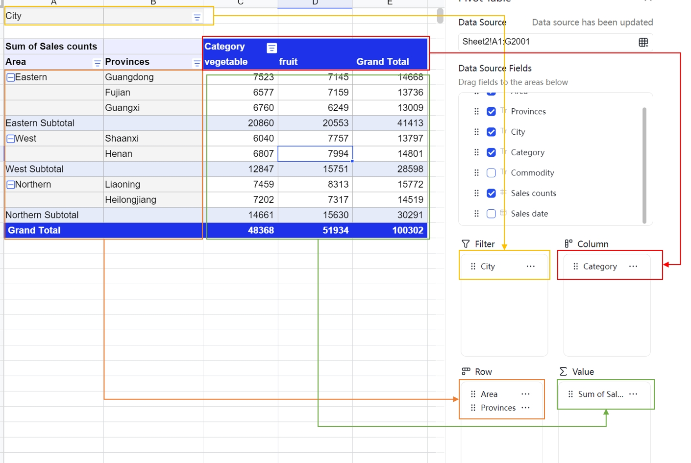

<MetaData
  lang="zh-CN"
  meta={{
    mobile: true,
    preset: [{
      client: '@univerjs/preset-sheets-advanced',
      locale: '@univerjs/preset-sheets-advanced/locales/zh-CN',
      style: '@univerjs/preset-sheets-advanced/lib/index.css',
    }],
    plugins: [{
      client: '@univerjs-pro/sheets-pivot',
      facade: '@univerjs-pro/sheets-pivot/facade',
      locale: '@univerjs-pro/sheets-pivot/locale/zh-CN',
    }, {
      client: '@univerjs-pro/sheets-pivot-ui',
      locale: '@univerjs-pro/sheets-pivot-ui/locale/zh-CN',
      style: '@univerjs-pro/sheets-pivot-ui/lib/index.css',
    }],
    server: false,
  }}
/>

数据透视表将大量数据汇总成一张紧凑的报表。它支持汇总、分析和可视化数据，并提供多种数据操作和格式设置，使结果更容易理解。

## 简介

数据透视表通常用于以下四种场景：

- 汇总大量数据，以呈现整体情况。
- 分析数据，识别其中的模式和关系。
- 探索数据，发现其中的规律和趋势。
- 可视化数据，使结果更容易理解。

数据透视表通常由三部分组成：

- 行标签：按行对数据分组。
- 列标签：按列对数据分组。
- 值：汇总每个交叉位置上的数字。

行标签、列标签和值均可随时调整，以适应分析需求的变化。



### 数据源

在 Univer Sheets 中，数据源可以是一整张工作表（Worksheet），也可以是一个数据区域。

数据源的第一行会成为列标签，其余行是数据。空行和空列会干扰这一布局，因此数据源应当保持规整。

每一列的数据类型都会被自动识别，透视表据此决定该字段可以执行哪些操作。如果一列中的数据类型不一致，整列都按字符串处理。

透视表会跟踪数据源的变化：当数据源中的值发生变化时，透视表会自动更新。

### 筛选

行标签和列标签都可以筛选。另有一个筛选字段，它不参与报表的行列布局，但其中选中的值同样会限定数据范围。

筛选有两种方式：

- 标签筛选：作用于当前标签维度的项（item）。例如在省份维度下，可以筛选掉部分省份。
- 值筛选：需要先指定一个值维度，再按汇总结果筛选。例如筛选掉销售额低于 1000 的数据。

### 排序

排序仅对行字段和列字段生效，支持升序和降序，比较使用 localCompare 方法。后续将支持更多比较方式，例如拼音排序。

排序有两种方式：

- 标签排序：作用于当前标签维度的项（item）。例如在省份维度下，可以按省份名称排序。
- 值排序：需要先指定一个值维度，再按汇总结果排序。例如按销售额排序。

### 汇总

数据透视表支持 Excel 提供的 11 种汇总方式：求和、计数、数据计数、平均值、最大值、最小值、阶乘、标准差、方差、总体标准差、总体方差。

可以添加多个值维度，并可设置值维度所在的区域（value position）及其在该区域中的顺序（value index）。

这一布局逻辑较为复杂，因此目前仅支持表格视图，后续将根据需求支持更多视图。

### 下钻

下钻是指在值区域中双击某个单元格，查看该单元格背后的明细数据。明细数据会列出产生该数值的各行，因此可以将汇总值追溯到源数据。

### 分组

Univer Sheets 支持日期分组、数字分组和手动分组。

- 日期分组：对派生日期字段使用 [`setDateGroupType`](/reference/facade/pivot-table#setdategrouptype) 设置。若要按日历单位对原始日期标签字段分组，先将 [`setDateGroupingMode`](/reference/facade/pivot-table#setdategroupingmode) 设为 `univerAPI.Enum.PivotDateGroupingMode.ExcelLike`，再调用 [`setExcelDateGroup`](/reference/facade/pivot-table#setexceldategroup)。
- 数字分组：向 [`setNumberGroup`](/reference/facade/pivot-table#setnumbergroup) 传入标签字段 ID 和区间设置。
- 手动分组：向 [`setManualGroups`](/reference/facade/pivot-table#setmanualgroups) 传入原始源字段 ID 以及按类型分组的成员。每组至少包含两个成员；传入空数组会移除该字段的全部手动分组。

[切片器和时间线](/guides/sheets/features/slicer)可以交互式筛选表格和透视报表。

## 插件模式

### 安装

```package-install
npm install @univerjs-pro/sheets-pivot @univerjs-pro/sheets-pivot-ui
```

### 使用

```typescript
import { UniverSheetsPivotTablePlugin } from '@univerjs-pro/sheets-pivot' // [!code ++]
import { UniverSheetsPivotTableUIPlugin } from '@univerjs-pro/sheets-pivot-ui' // [!code ++]
import SheetsPivotTableUIZhCN from '@univerjs-pro/sheets-pivot-ui/locale/zh-CN' // [!code ++]
import SheetsPivotTableZhCN from '@univerjs-pro/sheets-pivot/locale/zh-CN' // [!code ++]
import { LocaleType, mergeLocales, Univer } from '@univerjs/core'
import '@univerjs-pro/sheets-pivot-ui/lib/index.css' // [!code ++]
import '@univerjs-pro/sheets-pivot/facade' // [!code ++]

const univer = new Univer({
  locale: LocaleType.ZH_CN,
  locales: {
    [LocaleType.ZH_CN]: mergeLocales(
      SheetsPivotTableZhCN, // [!code ++]
      SheetsPivotTableUIZhCN, // [!code ++]
    ),
  },
})
```

### 插件注册

透视表插件有两种注册方式，区别在于将多少计算保留在主进程上。

**只注册在主进程**

该模式适用于轻量级任务和简单操作：插件 config 可以保持为空，只需引入 `UniverSheetsPivotTablePlugin` 即可。

```typescript
univer.registerPlugin(UniverSheetsPivotTablePlugin)
univer.registerPlugin(UniverSheetsPivotTableUIPlugin)
```

**主进程和 worker 进程同时注册**

当透视表计算量较大时，可以将插件同时注册到主进程和 worker 进程。插件随后可以使用多线程架构完成数据分发和计算，将大部分计算从主进程移出，从而提升整体性能。

在该模式下，主进程负责数据分发、同步和渲染，worker 进程负责复杂计算。该模式在注册时通过 config 选择。

```typescript
// 浏览器主进程插件注册文件
// notExecuteFormula 为 true 表示主进程不执行计算，只负责数据的分发、同步和渲染
univer.registerPlugin(UniverSheetsPivotTablePlugin, { notExecuteFormula: true })
univer.registerPlugin(UniverSheetsPivotTableUIPlugin)

// web worker 进程插件注册文件
// notExecuteFormula 为 false 表示 worker 进程执行计算
univer.registerPlugin(UniverSheetsPivotTablePlugin, { notExecuteFormula: false })
```

如果你拥有 Univer 的商业许可证，客户端侧的配置方式见[在客户端使用许可证](/server/license#in-plugin-mode)。

### 插件配置 [#plugin-configuration]

`UniverSheetsPivotTablePlugin`

| <span data-config-options="">配置项</span> | 类型 | 默认值 | 作用 |
| --- | --- | --- | --- |
| `maxLimitItemCount` | `number` | `1000` | 单个透视表字段可显示的项目数上限。 |
| `autoDateGroup` | `boolean` | `true` | 将日期字段加入行或列时自动分组。 |
| `dateSystem` | `DateSystem` | `DateSystem.Date1900` | 用于日期分组的日期系统。 |
| `notExecuteFormula` | `boolean` |  | 指定透视表计算角色。主线程传 `true`，worker 进程传 `false`。单线程使用时省略。 |

## 移动端适配 [#mobile-support]

请先配置[移动端编辑器](/guides/sheets/getting-started/installation#mobile-support)。然后在本页插件模式的初始化代码中，将下列桌面端注册替换为同一个包导出的移动端插件，并在**打开文档前**完成替换。模型插件、样式、语言包和 Facade 导入均需保留，两个版本不要同时注册。

| 来源包 | 桌面端注册 | 移动端注册 |
| --- | --- | --- |
| `@univerjs-pro/sheets-pivot-ui` | `UniverSheetsPivotTableUIPlugin` | `UniverSheetsPivotTableMobileUIPlugin` |

## 预设模式

透视表功能包含在 `@univerjs/preset-sheets-advanced` 预设中，该预设还包含绘图、水印等其他高级功能。

### 安装

<Callout>
  @univerjs/preset-sheets-advanced 的 `UniverSheetsAdvancedPreset` 预设在运行时依赖 `UniverSheetsDrawingPreset` 预设，因此需要先安装 @univerjs/preset-sheets-drawing。
</Callout>

```package-install
npm install @univerjs/preset-sheets-drawing @univerjs/preset-sheets-advanced
```

### 使用

```typescript
import { UniverSheetsAdvancedPreset } from '@univerjs/preset-sheets-advanced' // [!code ++]
import UniverPresetSheetsAdvancedZhCN from '@univerjs/preset-sheets-advanced/locales/zh-CN' // [!code ++]
import { UniverSheetsCorePreset } from '@univerjs/preset-sheets-core'
import UniverPresetSheetsCoreZhCN from '@univerjs/preset-sheets-core/locales/zh-CN'
import { UniverSheetsDrawingPreset } from '@univerjs/preset-sheets-drawing' // [!code ++]
import UniverPresetSheetsDrawingZhCN from '@univerjs/preset-sheets-drawing/locales/zh-CN' // [!code ++]
import { createUniver, LocaleType, mergeLocales } from '@univerjs/presets'
import '@univerjs/preset-sheets-core/lib/index.css'
import '@univerjs/preset-sheets-drawing/lib/index.css' // [!code ++]
import '@univerjs/preset-sheets-advanced/lib/index.css' // [!code ++]

const { univerAPI } = createUniver({
  locale: LocaleType.ZH_CN,
  locales: {
    [LocaleType.ZH_CN]: mergeLocales(
      UniverPresetSheetsCoreZhCN,
      UniverPresetSheetsDrawingZhCN, // [!code ++]
      UniverPresetSheetsAdvancedZhCN, // [!code ++]
    ),
  },
  presets: [
    UniverSheetsCorePreset(),
    UniverSheetsDrawingPreset(), // [!code ++]
    UniverSheetsAdvancedPreset(), // [!code ++]
  ],
})
```

如果你拥有 Univer 的商业许可证，客户端侧的配置方式见[在客户端使用许可证](/server/license#in-preset-mode)。

### 预设配置 [#preset-configuration]

`UniverSheetsAdvancedPreset`

| <span data-config-options="">配置项</span> | 类型 | 默认值 | 作用 |
| --- | --- | --- | --- |
| <ConfigKey depth={0}>pivot</ConfigKey> | `object` |  | 该功能的配置项。 |
| <ConfigKey depth={1}>maxLimitItemCount</ConfigKey> | `number` | `1000` | 单个透视表字段可显示的项目数上限。 |

## Facade API

完整的 Facade API 类型定义见 [FacadeAPI](/reference/facade)。

### 引入

<Callout type="info" title="插件模式提示">
  只有插件模式需要手动引入 Facade 包。预设模式已内置对应的包，无需再次引入。
</Callout>

```typescript
import '@univerjs-pro/sheets-pivot/facade'
```

### 添加透视表

[`FWorkbook.addPivotTable`](https://docs.univer.ai/reference/facade/workbook#addpivottable) 用于添加透视表，成功时返回 `FPivotTable` 实例。

```typescript
// 需要确保工作表范围 A1:G9 是非空的
const fWorkbook = univerAPI.getActiveWorkbook()
const unitId = fWorkbook.getId()
const fSheet = fWorkbook.getActiveSheet()
const subUnitId = fSheet.getSheetId()
const sheetName = fSheet.getSheetName()
const sourceInfo = {
  unitId,
  subUnitId,
  sheetName,
  range: {
    startRow: 0,
    startColumn: 0,
    endRow: 8,
    endColumn: 6,
  },
}
const anchorCellInfo = {
  unitId,
  subUnitId,
  row: 20,
  col: 8,
}
const fPivotTable = await fWorkbook.addPivotTable(sourceInfo, univerAPI.Enum.PositionTypeEnum.Existing, anchorCellInfo)
const pivotTableId = fPivotTable.getPivotTableId()
// 设置状态，避免重复添加维度
let hasAdded = false
// 透视表的创建是异步的，因此需要等待透视表渲染完成后再添加维度
univerAPI.addEvent(univerAPI.Event.PivotTableRendered, async (params) => {
  if (!hasAdded && params.pivotTableId === pivotTableId) {
    hasAdded = true
    await fPivotTable.addField(1, univerAPI.Enum.PivotTableFiledAreaEnum.Row, 0)
    await fPivotTable.addField(1, univerAPI.Enum.PivotTableFiledAreaEnum.Value, 0)
  }
})
```

### 获取透视表

[`FWorkbook.getPivotTableByCell`](https://docs.univer.ai/reference/facade/workbook#getpivottablebycell) 按锚定单元格查找透视表；如果目标单元格位于某个透视表内，则返回 `FPivotTable`。

```typescript
const fWorkbook = univerAPI.getActiveWorkbook()
const unitId = fWorkbook.getId()
const fSheet = fWorkbook.getActiveSheet()
const subUnitId = fSheet.getSheetId()

// 从 FWorkbook 中获取透视表实例
const fPivotTable = fWorkbook.getPivotTableByCell(unitId, subUnitId, 0, 8)

// 从 FSheet 中获取透视表实例
const pivotTable2 = fSheet.getPivotTableByCell(0, 8)
```

[`FPivotTable`](https://docs.univer.ai/reference/facade/pivot-table) 提供用于操作透视表的方法。

| 方法                                                                                                                           | 描述                                                                    |
| ------------------------------------------------------------------------------------------------------------------------------ | ---------------------------------------------------------------------- |
| [remove](/reference/facade/generic-pivot-table#remove)                             | 从实例上移除透视表                                                      |
| [getConfig](https://docs.univer.ai/reference/facade/pivot-table#getconfig)                       | 返回透视表配置：源区域信息、锚定单元格信息和字段配置                      |
| [addField](https://docs.univer.ai/reference/facade/pivot-table#addfield)                         | 添加一个字段                                                            |
| [removeField](https://docs.univer.ai/reference/facade/pivot-table#removefield)                   | 移除一个字段                                                            |
| [updateFieldPosition](https://docs.univer.ai/reference/facade/pivot-table#updatefieldposition)   | 更新字段所在的区域和位置                                                 |
| [updateValuePosition](https://docs.univer.ai/reference/facade/pivot-table#updatevalueposition)   | 控制 ∑Value 的位置                                                      |
| [setSubtotalType](https://docs.univer.ai/reference/facade/pivot-table#setsubtotaltype)           | 设置字段的汇总方式                                                      |
| [setLabelSort](https://docs.univer.ai/reference/facade/pivot-table#setlabelsort)                 | 设置字段的标签排序                                                      |
| [setLabelManualFilter](https://docs.univer.ai/reference/facade/pivot-table#setlabelmanualfilter) | 设置字段的标签筛选                                                      |
| [renameField](https://docs.univer.ai/reference/facade/pivot-table#renamefield)                   | 重命名字段                                                              |
| [setValueFilter](/reference/facade/pivot-table#setvaluefilter)             | 设置值筛选                                                              |
| [reset](/reference/facade/generic-pivot-table#reset)                               | 重置透视表的字段                                                        |
| [setFieldsConfig](https://docs.univer.ai/reference/facade/pivot-table#setfieldsconfig)           | 设置透视表的字段配置                                                    |
| [getValueFilters](https://docs.univer.ai/reference/facade/pivot-table#getvaluefilters)           | 获取透视表上的全部值筛选                                                |

### 事件监听

完整的事件类型定义见 [Events](https://docs.univer.ai/reference/facade/events)。

`univerAPI.Event.BeforePivotTableAdd` 在添加透视表前触发。

```typescript
const disposable = univerAPI.addEvent(univerAPI.Event.BeforePivotTableAdd, (params) => {
  const { positionType, targetCellInfo } = params
  if (positionType === univerAPI.Enum.PositionTypeEnum.Existing && targetCellInfo.sheetName === 'Sheet 1') {
    // 取消添加透视表操作
    params.cancel = true
    console.log(`无法将透视表添加到 ${targetCellInfo.sheetName} 工作表`)
  }
})

// 移除事件监听器，使用 `disposable.dispose()`
```

`univerAPI.Event.PivotTableAdded` 在添加透视表后触发。

```typescript
const disposable = univerAPI.addEvent(univerAPI.Event.PivotTableAdded, (params) => {
  const { positionType, targetCellInfo } = params
  if (positionType === univerAPI.Enum.PositionTypeEnum.Existing) {
    console.log('在现有工作表中创建了一个透视表')
    console.log(`
      目标工作表名称为 ${targetCellInfo.sheetName},
      目标行为 ${targetCellInfo.row}, 目标列为 ${targetCellInfo.column}
    `)
  } else {
    console.log('在新工作表中创建了一个透视表')
  }
})

// 移除事件监听器，使用 `disposable.dispose()`
```

`univerAPI.Event.BeforePivotTableMove` 在移动透视表前触发。

```typescript
const disposable = univerAPI.addEvent(univerAPI.Event.BeforePivotTableMove, (params) => {
  const { pivotTableId, targetCellInfo } = params
  if (pivotTableId === 'pivotTable1' && targetCellInfo.sheetName === 'Sheet 1') {
    // 取消移动透视表操作
    params.cancel = true
    console.log(`无法将透视表移动到 ${targetCellInfo.sheetName} 工作表`)
  }
})

// 移除事件监听器，使用 `disposable.dispose()`
```

`univerAPI.Event.PivotTableMoved` 在移动透视表后触发。

```typescript
const disposable = univerAPI.addEvent(univerAPI.Event.PivotTableMoved, (params) => {
  const { pivotTableId, targetCellInfo, originTargetInfo } = params
  if (pivotTableId === 'pivotTable1') {
    console.log(`
      透视表从行: ${originTargetInfo.row} & 列: ${originTargetInfo.column}
      移动到工作表 ${targetCellInfo.sheetName} 行: ${targetCellInfo.row} & 列: ${targetCellInfo.column}
    `)
  }
})

// 移除事件监听器，使用 `disposable.dispose()`
```

`univerAPI.Event.PivotTableRendered` 在透视表渲染完成后触发。

```typescript
// import { unionPivotViewRange } from '@univerjs-pro/sheets-pivot';
const disposable = univerAPI.addEvent(univerAPI.Event.PivotTableRendered, (params) => {
  const { pivotTableId, rangeInfo } = params
  console.log(`透视表 ${pivotTableId} 已渲染`)
  if (rangeInfo) {
    console.log(unionPivotViewRange(rangeInfo))
  }
})

// 移除事件监听器，使用 `disposable.dispose()`
```

`univerAPI.Event.PivotTableRemoved` 在透视表被移除后触发。

```typescript
const disposable = univerAPI.addEvent(univerAPI.Event.PivotTableRemoved, (params) => {
  const { pivotTableId } = params
  console.log(`透视表 ${pivotTableId} 已被删除`)
})

// 移除事件监听器，使用 `disposable.dispose()`
```

`univerAPI.Event.PivotTableFieldAdded` 在透视表添加字段后触发。

```typescript
const fWorkbook = univerAPI.getActiveWorkbook()
const disposable = univerAPI.addEvent(univerAPI.Event.PivotTableFieldAdded, (params) => {
  const { pivotTableId, fieldId, fieldArea, fieldIndex } = params
  const pivotTable = fWorkbook.getPivotTableById(pivotTableId)
  const fieldSetting = pivotTable.getFieldSetting(fieldId)
  console.log(fieldSetting)
})

// 移除事件监听器，使用 `disposable.dispose()`
```

`univerAPI.Event.PivotTableFieldRemoved` 在透视表移除字段后触发。

```typescript
const fWorkbook = univerAPI.getActiveWorkbook()
const disposable = univerAPI.addEvent(univerAPI.Event.PivotTableFieldRemoved, (params) => {
  const { pivotTableId, fieldId } = params
  const pivotTable = fWorkbook.getPivotTableById(pivotTableId)
  const fieldSetting = pivotTable.getFieldSetting(fieldId)
  console.log(fieldSetting)
})

// 移除事件监听器，使用 `disposable.dispose()`
```

`univerAPI.Event.PivotTableFieldMoved` 在透视表里移动字段后触发。

```typescript
const fWorkbook = univerAPI.getActiveWorkbook()
const disposable = univerAPI.addEvent(univerAPI.Event.PivotTableFieldMoved, (params) => {
  const { pivotTableId, fieldId, fieldArea, fieldIndex } = params
  const pivotTable = fWorkbook.getPivotTableById(pivotTableId)
  const fieldSetting = pivotTable.getFieldSetting(fieldId)
  console.log(`源名称 ${fieldSetting.sourceName} 显示名称 ${fieldSetting.displayName}`)
})

// 移除事件监听器，使用 `disposable.dispose()`
```

`univerAPI.Event.PivotTableFieldCollapseChanged` 在透视表里展开或折叠维度后触发。

```typescript
const fWorkbook = univerAPI.getActiveWorkbook()
const disposable = univerAPI.addEvent(univerAPI.Event.PivotTableFieldCollapseChanged, (params) => {
  const { pivotTableId, fieldId, isCollapsed } = params
  const pivotTable = fWorkbook.getPivotTableById(pivotTableId)
  const fieldSetting = pivotTable.getFieldSetting(fieldId)
  console.log(`源名称 ${fieldSetting.sourceName} 显示名称 ${fieldSetting.displayName}`)
})

// 移除事件监听器，使用 `disposable.dispose()`
```

`univerAPI.Event.PivotTableFieldFilterChanged` 在透视表里筛选维度后触发。

```typescript
const fWorkbook = univerAPI.getActiveWorkbook()
const disposable = univerAPI.addEvent(univerAPI.Event.PivotTableFieldFilterChanged, (params) => {
  const { pivotTableId, fieldId, filter } = params
  const pivotTable = fWorkbook.getPivotTableById(pivotTableId)
  const fieldSetting = pivotTable.getFieldSetting(fieldId)
  console.log(`检查列表筛选值为 ${fieldSetting.filterInfo.checklist}`)
})

// 移除事件监听器，使用 `disposable.dispose()`
```

`univerAPI.Event.PivotTableFieldSortChanged` 在透视表里排序维度后触发。

```typescript
const fWorkbook = univerAPI.getActiveWorkbook()
const disposable = univerAPI.addEvent(univerAPI.Event.PivotTableFieldSortChanged, (params) => {
  const { pivotTableId, fieldId, sort } = params
  const pivotTable = fWorkbook.getPivotTableById(pivotTableId)
  const fieldSetting = pivotTable.getFieldSetting(fieldId)
  console.log(`排序信息为 ${fieldSetting.sortInfo}`)
})

// 移除事件监听器，使用 `disposable.dispose()`
```

`univerAPI.Event.PivotTableFieldSettingChanged` 在透视表里改动维度设置后触发。

```typescript
const fWorkbook = univerAPI.getActiveWorkbook()
const disposable = univerAPI.addEvent(univerAPI.Event.PivotTableFieldSettingChanged, (params) => {
  const { pivotTableId, fieldId, setting } = params
  const pivotTable = fWorkbook.getPivotTableById(pivotTableId)
  const fieldSetting = pivotTable.getFieldSetting(fieldId)
  console.log(`源名称 ${fieldSetting.sourceName} 显示名称 ${fieldSetting.displayName}`)
})

// 移除事件监听器，使用 `disposable.dispose()`
```

`univerAPI.Event.PivotTableValuePositionChanged` 在透视表里改动值位置后触发。

```typescript
const fWorkbook = univerAPI.getActiveWorkbook()
const disposable = univerAPI.addEvent(univerAPI.Event.PivotTableValuePositionChanged, (params) => {
  const { pivotTableId, valueId, position } = params
  const pivotTable = fWorkbook.getPivotTableById(pivotTableId)
  const valueSetting = pivotTable.getValueSetting(valueId)
  console.log(`源名称 ${valueSetting.sourceName} 显示名称 ${valueSetting.displayName}`)
})

// 移除事件监听器，使用 `disposable.dispose()`
```

## 输出区域被占用 [#blocked-output]

报表需要预留扩展空间。已有的单元格内容、合并单元格或其他透视表都可能遮挡输出区域。请清除障碍，或将报表移动到空白区域。

## 值显示方式 [#show-values-as]

对值字段调用 `setShowDataAs()` 可以改变该字段显示的值，例如它占某一行、某一列或总计的百分比，或相对于基准项的差异。改变的只是显示的计算方式，源数据不会被修改。`getShowDataAs()` 读取当前设置，`resetShowDataAs()` 恢复常规计算。

```ts
const valueId = fPivotTable.getFieldIdsByArea(
  univerAPI.Enum.PivotTableFiledAreaEnum.Value,
)[0]
if (valueId) {
  await fPivotTable.setShowDataAs(valueId, {
    type: univerAPI.Enum.PivotShowAsTypeEnum.percentOfGrandTotal,
  })
  console.log(fPivotTable.getShowDataAs(valueId))
}
```

示例假设已有一个 `fPivotTable`。此处传入的是值字段 ID，而不是源列或行字段 ID。差异和累计等模式还需要对应的基准字段与基准项设置。

## 随工作表复制透视表 [#copy-with-worksheet]

注册透视表插件后，复制工作表会一并复制该工作表上的透视表，并保留其字段配置。每个副本都会获得新的透视表 ID。位于被复制工作表上的数据源范围会改为指向新工作表；位于其他工作表或工作簿上的数据源则保留原引用。复制出的透视表会参与工作表复制操作的撤销和重做。

```ts
const workbook = univerAPI.getActiveWorkbook()
if (!workbook) throw new Error('No active workbook')

const copiedSheet = workbook.duplicateActiveSheet()
console.log(copiedSheet.getSheetName())
```

## 多重筛选与日期条件 [#multiple-filters]

`setOptions({ allowMultipleFilters: true })` 允许同一字段上的成员选择、标签或日期条件以及值筛选共存。如果省略该选项或传入 `false`，新筛选会替换原有筛选，而不是叠加；如果关闭该选项时存在类别冲突，则会清除报表筛选。一个字段仍然最多只能有一个值筛选。

`setDateFilter()` 接受固定日期运算符，包括 `dateEqual`、`dateOlderThan` 和 `dateBetween`。`expected` 保存的是工作簿日期系统中的 Excel 序列值，区间条件需要两个这样的值。`useWholeDay: true` 忽略一天中的具体时间，按整天比较；如果省略该选项或传入 `false`，则按精确序列值比较。此处传入报表字段 ID，而不是源列索引。以下示例沿用前文的 `fPivotTable`，并要求数据源中有一列名为 `Date`。

`getDateFilter()` 返回条件的独立副本，`clearDateFilter()` 只清除日期条件。这两个命令都支持撤销和协同。请检查它们返回的布尔值：已生效的切片器可能会阻止不兼容的筛选被应用。

```ts
if (!fPivotTable) throw new Error('PivotTable not found')
await fPivotTable.setOptions({ allowMultipleFilters: true })

const dateField = Object.values(fPivotTable.getConfig()?.fieldsConfig.dimension ?? {})
  .find((field) => field.sourceName === 'Date')
if (!dateField) throw new Error('Add the Date field to the report first')

await fPivotTable.setDateFilter(dateField.id, {
  operator: univerAPI.Enum.ST_PivotFilterOperatorEnum.dateEqual,
  expected: 45293,
  useWholeDay: true,
})
console.log(fPivotTable.getDateFilter(dateField.id))
await fPivotTable.clearDateFilter(dateField.id)
```

## GETPIVOTDATA [#getpivotdata]

`=GETPIVOTDATA("Sales",$I$1,"Region","East")` 从一张左上角单元格为 I1 的可见透视表中读取聚合值。值字段可以用显示名称或源字段名指定。锚点必须是单个单元格引用，且字段/项目对必须完整成对提供。

当前实现只读取可见报表，从锚点向下最多扫描 200 行、向右最多扫描 50 列，不查询隐藏的源记录。字段/项目对不匹配，或结果不可用时，返回 `#REF!`；参数数量不正确，或锚点不是单个单元格时，返回 `#VALUE!`。
